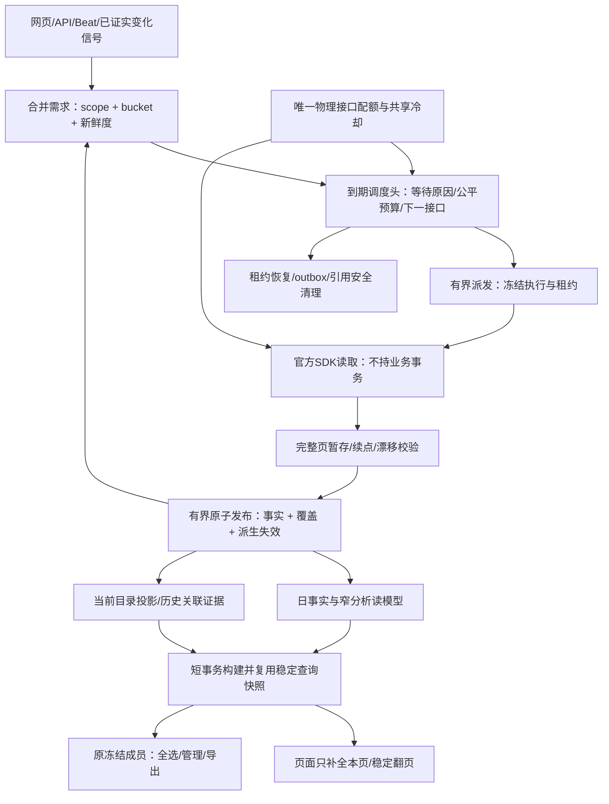

# TK-ADA 同步、数据底座与报表查询整体优化方案

状态：**待评审的完整目标方案，尚未实施或发布**。日期：2026-10-31。

代码基线：本地 `12d24fa3`；本轮性能取证生产 `0642ad3d`/0067；巨量参考 `8b2e9ee1b`。本方案落实用户“先整体设计，再一次按完整方案解决”的要求；分包是为了可验证和可迁移，不将局部上线当作整体结案。

版本补注：文档收尾时，[另一发布流程的最终回执](../../validation/2026-10-31-bulk-production-release.md)记录北京时间02:06完成12d24fa3/0069及BASIC实际配置、11角色验收。本轮性能证据仍取自切换前0642ad3d，不作为新版本表现。执行本方案前重新采集当前基线；沿用已确认的BASIC授权，不重复请求，不把它当成更高额度许可。

配套：[参考项目与新证据](../../validation/2026-10-31-oceanengine-comparison.md)、[历史305提交复盘](../../validation/2026-10-31-sync-chain-audit.md)、[实施计划](../plans/2026-10-31-sync-query-redesign.md)。本方案统一后续性能工作，替代继续从旧审计清单任选一项独立调参；既有统一配额/批量管理代码作为依赖，不能重复造另一套quota。

## 1. 目标、证据和非目标

要同时解决四件事：页面首屏与翻页慢；新数据不够新；历史工作消化慢；运行时间越长，调度、暂存和历史身份成本越高。不能靠丢弃任务、减少授权范围、漏晚到修正、伪造素材关系或隐藏失败来改善数字。

已证明的结构事实：

- 首屏先聚合/排序全部匹配对象，持久化成员快照和汇总，再取50行重新补全；素材每页仍可能读取全日期范围帖子映射。
- 报表与余额的部分HTTP读取发生在业务数据库事务和锁内。
- 现有任务在领取之后才争取接口额度，大量本地拒绝会产生重复调度成本；若接口已接近10QPS，不可能仅改本地等待让有效API翻倍。
- 目录约2693万身份、素材引用3504万身份、outbox约1459万记录，库约111GiB；这是现在的规模，非未来假设。对象是同身份UPSERT，不是每轮复制全快照。
- 巨量主要来源是SPI+RDS增量，能用远端更新时间游标；TikTok未确认有同等来源。可学其有界读取、页内补全、版本防旧覆盖和分层修正，不能照搬接口吞吐。

尚未证明：页面各阶段生产P95、DB实际CPU/IO饱和比例、全部请求中可省比例、实际app额度等级、24小时新需求量。因此下文数字是**验收目标/实验边界**，不是宣称已经达到或保证提速倍数。

本期选择 PostgreSQL + Redis + Celery + 官方 SDK，不先引入 Kafka、ClickHouse、全量CDC、跨库双写或新HTTP平台客户端。不以换数据库代替查询与调度合同治理；若经过混合负载验证PG不能达到目标，再根据第9节条件评估读副本/分析库。

## 2. 一个统一目标架构

唯一事实源仍在PG；Redis负责唤醒、配额、短期缓存，不保存唯一业务进度。查询、同步读取、发布、控制维护使用独立并发预算，但总数据库连接预算必须统一核算。每个发布单元同时产生覆盖版本和派生更新信号，防止“事实写了、查询模型永远未更新”。

### 必须保留的现有能力

现有活跃筛选、部分scope去重、1–5账户BASIC批量、分页完整性检查、事实集合替换、目录UPSERT、campaign日汇总、类型化素材补链、冻结授权、outbox、稳定序号cursor、15分钟快照、已存在的清理和前端取消均保留其正确语义。实施任务必须写出替换的旧入口和保留的回归，不允许新旧调度永久并行。

## 3. 同步控制合同：需求不再等于一次执行任务

### 3.1 最小持久模型

在 `backend/app/modules/sync_control/` 集中控制合同，reporting/ads仍拥有各自业务reader、validator、publisher。不新增一整套重复业务执行表：

| 新增/调整 | 身份与责任 |
| --- | --- |
| `sync_scope` 新增 | tenant、BC、connection、binding generation、channel、actor/授权语义、resource、advertiser、规范筛选/指标/时区合同；priority、lane、账户打包方式不进入身份 |
| `sync_requirement` 新增 | `(scope_id,bucket_key)` 一条当前需求；日期/定向ID范围、desired_revision、requested_after、deadline、最老未满足时间、原因。覆盖完成后保留水位；新需求提升revision |
| `sync_schedule` 新增 | `(scope_id,work_class)` 一个调度头；next_eligible_at、等待原因、下一物理endpoint、cost、lease/generation、公平游标。只查到期活跃头 |
| `sync_execution_scope` 新增 | 按execution×scope×bucket×冻结requirement revision关联既有report job/directory run/balance run，保存每个子桶的发布版本/状态；支持一个BASIC执行合法打包多账户，不按批次重复生成需求 |
| 既有执行/暂存表 | 增加统一contract版本、owner epoch、fencing generation和必要checkpoint元数据；继续使用已有页表，迁移后不永久存两份页正文 |
| 既有coverage/outbox | ReportSyncState及目录覆盖补充发布版本/摘要；outbox补owner、contract、generation、有效期和清理证据；依赖仍复用已有补链账本，不另造消息系统 |

`bucket_key` 是具体账户当地日期/目录冻结分区/有界定向集合，不能把所有历史日期压成一个不可核验JSON。允许多个scope需求被一个合法读取满足；身份不一致、授权代数不同、账户时区/查询合同不兼容时禁止合并。

新请求不能扩大已经开始的冻结查询。若执行读取开始早于新需求 `requested_after`，本次完成只满足它冻结的revision；更晚刷新保留后继。进度已推进不因提高优先级重置，未知来源的变化不伪造增量游标。

### 3.2 状态与等待

执行统一阶段：`READY → LEASED → FETCHING → STAGED → PUBLISH_READY → PUBLISHING → COMPLETE`。持久字段可以映射到既有状态，不必为每个词新增一套表。

等待必须另列原因：`FUTURE_SCHEDULE / QUOTA / PROVIDER_COOLDOWN / FAIR_BUDGET / CAPACITY / DEPENDENCY / RETRY`，附下一可运行时间。撤权/解绑进入明确不可运行终态；不能自动用新绑定继续旧执行。需求为PENDING/SATISFIED/SUPERSEDED；合并替代不记成“完成了同步”。

产品分别显示 `facts_current`、`directory_complete`、`material_links_complete`、`asset_displayable`。事实已发布仍可查，关联未完整的行保留真实身份、金额和缺口；操作需要的身份不足时继续禁止猜测操作对象。

### 3.3 配额前移与公平调度

唯一发送准入沿用 `platform_quotas.py → admission_policy → admission.lua → gateway`。先验明生产app档位、物理endpoint例外和MCP独立合同，再选择实际额度。

- 调度查询同一账本的下一可用时间/cooldown/在途状态，**不提前扣次数**。已知不可运行只更新调度头；每物理endpoint合并一份到期唤醒，而非每个等待任务入队。
- endpoint派发量受可用Worker槽、预计未来一秒合法额度、app/tenant/advertiser资源在途预算共同约束。增加按endpoint原子登记的本机派发占位，键含owner epoch/execution/generation/step，queued与leased尚未发送的工作都计入；与actual inflight交接，不同时重复占位，取消/过期按围栏回收。它不消费平台次数，不是第二套quota。多Control同时派发不能重复使用同一空额。
- Worker发送前仍做原Lua准入；本地占位只允许明确的请求/时间预算，页内每个额外HTTP须取得下一份本机预算，可用时直接续步，不可用则保存续点让出，不能无界绕过派发。允许少量竞争拒绝；拒绝回写调度头，不新增一串独立重试任务。
- 首期不引入可转移permit，避免调度和发送双扣。Lua释放并发不能返还已发送次数；Redis重启也不能假定平台窗口重新开始。
- endpoint下先租户公平，再在可用工作类间分配成本预算。初始待压测权重：实时50、历史事实30、目录/关联15、维护/余额5；无对应工作类时归一、空闲可借用、页边界归还，持久化deficit及最老等待时间。它们是本机公平权重，不创造平台额度。
- 每步按请求/槽秒估算成本，完成后修正；大账户长页链不能连续占用整个窗口。当前endpoint被平台暂停时，不阻塞其他独立endpoint。
- 管理写入、上传纳入相同物理账本；上传磁盘/内存准入独立，不能把50在途照抄到所有Worker。

### 3.4 减少请求：明确做什么，不再重复“加缓存”

1. 保留活跃筛选，增加每scope的变更率、最近真实变化和晚到修订观测；新建/重新活跃账户有定向唤醒及周期兜底，不能仅凭无消耗停止发现。
2. 现有今天热同步、昨日收尾、近期归因修正、冷历史首次回补分别成为需求来源。初次切换保持原日期覆盖及周期；先影子评估哪些无变化请求可降频，再提交明确的频率矩阵。不得未测就直接缩短31天修正范围。
3. 相同冻结scope、规范query、schema、观察时点及完整性证据的响应可服务多个相容需求；已保存的页面继续用，部分页/过期快照不能成为“查无结果”的负缓存。
4. 一次确定广告归属后补齐本响应所有相关帖子；已完成的这类复用保留。缺目录只发定向目录需求，不能重新请求已新鲜的金额报表。
5. 变化的目录/名称/素材链接只触发本地受影响读模型重建，不触发无关平台事实重新拉取。
6. 异步报表、修改时间筛选、更大页数仅在官方合同证明可用后进入adapter；本期验收不依赖尚未取得的平台能力。

## 4. 读取、发布和恢复：网络不再牵住数据库事务

一次页读取分三段：

- A短事务：验权、领取、冻结query及租约，提交。
- 网络阶段：无业务session/行锁/事务。发送前再读授权和围栏并关闭该短事务；无需跨HTTP保持锁。外部调用发出后发生撤权，响应可记录传输审计，但回写不得越权发布。
- B短事务：校验execution/generation/contract/query，幂等保存完整响应页、checkpoint与唯一后继消息。晚回包/旧代不能覆盖新代。

发布为C事务：账户×种类×当地日（目录为冻结分区）验证完整链后进行集合替换/UPSERT，推进coverage和已满足revision，落派生更新/依赖信号，一次提交。该事务同时登记execution_scope中对应子桶的已发布版本，只满足其冻结revision，不清除后来增长的desired_revision。父执行仅当全部必需子桶已发布或有明确supersede证据才终结；恢复只补未发布桶，已发布桶幂等跳过。不能只去掉旧账户advisory lock而不补发布水位CAS；account/ad对账明确消费的两个发布版本。

已存在的事实删除+插入语义保留：完整快照中消失的旧行必须删除。暂存用规范化行/唯一身份约束和流式或SQL校验，避免末页将全部页正文加载成Python大列表。目录保留同身份observed_at防旧覆盖。

巨大单日的决策规则：先用set-based暂存→发布和按账户日原子化；若在代表性最大桶发布仍不能满足第8节预算，必须在切换前升级该类publisher为“不可变dataset_generation + 可见指针”。该选择需要测出最大桶边界；禁止运行中临时拆提交破坏原子性。这是一个明确阻断条件，不允许超预算也带病上线。

快照漂移继续保留检测、重启epoch和合法拆分；源API没有强snapshot token时，明确完整性保证的边界，不能用总数相等证明绝对没有漂移。

围栏权威顺序固定：scope owner epoch最高，execution generation保护每次保存/发布，schedule lease只保护派发，不能自行生成第二个并行执行。恢复器只检查到期头、过期租约和未发布outbox。每个边界验证：DB已提交但ACK丢失、消息已发送但标记未提交、旧Worker失租仍回包。余额也走该合同；没有返回的账户标为缺失/等待，不填0或宣布全账户新鲜。

## 5. 数据库设计：事实、在线投影和历史证据分工

官方源表对照见[连山 RDS 结构审阅](../../validation/2026-10-31-lianshan-rds-schema-review.md)：依据参考仓库 2026-07-18 源 MySQL 只读结构快照，区别于应用本地 PG。它按订阅/报表族/日组织，提供源更新时间与账户/对象/时间索引；不能将其自然身份、按日表或每订阅独立库直接照搬到 TikTok。

### 5.1 保留事实表，增补必要读模型

| 数据 | 处理决定 | 更新与索引方向 |
| --- | --- | --- |
| ad/material日事实 | 保留现有按月分区与唯一身份，作为金额真相 | tenant/account/date精确查询；分区预建，发布热路径不临时ATTACH |
| campaign_report_day | 复用现有同事务汇总 | 不增加第二张同义系列汇总表 |
| adgroup_report_day | 新增，来自受影响ad日桶 | tenant/account/local_date/adgroup/currency；只重算受影响桶 |
| material_entity_day | 新增素材展示身份的日读模型 | 保留tenant/account/local_date/currency/type和稳定展示身份；原始帖子事实可回查，不跨账户预先合并权限 |
| ad_entity_read | 新增窄投影，非替代真相 | tenant/account/kind/remote_id；parent/name/status/budget/target_roas/created_local_date/versions类型化；JSON只在详情读取 |
| campaign_name_current | 新增最新命名单行投影 | 精确系列身份＋grouping/name revision；不再每页拉所有历史在Python取latest |
| current_ad_material | 新增当前使用位置投影 | 每广告/类型/素材按现有最新完整观察规则维护；歧义仍保留、不猜ID |
| material_post_link、历史引用 | 保留核算和关联证据 | 为本页视频→授权账户/日期帖子定位提供反向索引；不按全表最大version删除 |

不是按每个BC复制一套表，不按一张表太大就任意分库；租户/账户边界始终进入主键或约束。物理索引由真实查询前导列和冷热计划确定，避免所有字段都建索引的写放大。

### 5.2 派生模型必须可修正、可重建

原始日事实更正、归属补齐、类型变化、名称修订都会产生受影响bucket key。小的事实日汇总在同一发布事务维护；目录/链接导致的较大派生重算通过持久dirty bucket合并，按桶原子替换并推进自己的版本。查询记录事实与派生两个水位，派生落后不能伪装当前。素材金额和展示身份必须读取同一已提交派生桶；落后时返回该桶旧但完整的结果和真实水位/coverage，不混入新原始事实制造漏算或双算。不同桶允许不同水位并明确覆盖状态。

重建冻结输入revision N，发布用版本CAS，只确认处理到N，期间产生的N+1 dirty必须保留。回填开始前，所有仍运行的旧/新事实、目录、命名、链接写入口都已经同事务登记源版本和dirty信号；按桶检查回填边界后的增量追平，不只看回填游标结束。

相同旧事实重放不重复加金额；不能对现有总额直接累加一次又一次。一个帖子映射发生变化时，从旧展示身份扣除并给新身份重建，保留未知帖子行以防金额丢失/双算。ROAS按汇总收入/消耗计算，币种不混加，时区不偷偷转统一日期，轮播不要求视频VID，null/0/unsupported保持区分。

不先固化“剧名→金额”的永久汇总：剧名和分组会变，继续从稳定系列粒度按明确命名版本汇总。低使用维度不全量预计算。

### 5.3 保留期和增长

- 活跃页不能仅因年龄删除；沿用已有目录页/素材页保留参数，增加终态、发布证据、引用检查和迟到回包围栏。
- 新V2投递有效期建议7天；过期消息不得直接执行业务，由DB需求生成新代有效消息。终结outbox payload保留7天、幂等摘要30天，正式启用前验证最长任务/恢复窗口；legacy消息没有有效期时不得套此TTL。
- 终结运行摘要保留90天在线，之后归档；业务金额和素材身份没有默认自动删除期限。归档包含scope、版本、摘要、错误和审计引用，不承诺删掉仍被核算使用的历史。
- 清理按索引游标有界执行，记录每日新增/回收字节、最老可回收年龄；不通过删任务改善积压完成率。
- 新投影/索引会增加临时磁盘需求。迁移前测实际heap/index/TOAST与可用空间，计算旧表+新投影+索引构建+WAL的峰值；不能拿111GiB直接当内存需求或假定云盘上限。

### 5.4 DDL 前置审计

W0 必须交付“平台维度→事实粒度/唯一约束→展示身份→查询/索引→保留期”矩阵，W1 据此冻结 DDL。重点核实素材事实与链接的主键未含类型，而查询已区分类型的合同疑点：先确认 ID 唯一域及类型纠正语义，再决定是否改键；不能无证据宣称已发生覆盖，也不能直接加类型列造成纠正前后重复金额。

区分当地业务日、源更新时间（可缺失）、本地观测时间与发布版本；不得以 fetched_at 代替源变更水位。核实实际索引，比较单账户与跨账户的前导列、页内反查及写放大。日/月分区以当前最大桶和1/7/31/90日混合负载实验决定，默认保留月分区，实验若要求变更须在W1前修订本规格。发布热路径不得触发缺分区建表/DEFAULT搬迁；该路径现有显式强锁是条件性风险，不等于已证明当前持续锁库。

上述审计同时记录列宽、类型精度、分区heap/index/TOAST和迁移WAL峰值；ID或Numeric缩减必须有源合同和数据范围证明。新读模型金额、身份、类型纠正、时区及授权逐桶等价是切换门槛。

## 6. 页面查询：明确选择保留稳定快照，再缩小构建与翻页成本

### 6.1 本期选择与不选择

**保留现有成员/顺序/refs冻结、序号cursor、全选与导出合同。** 不首期改成随发布不断漂移的live keyset，不要求全库跨请求MVCC，不让“全部匹配”在点击提交时重新解释为另一批对象。这样避免用性能改造制造漏选、重选或跨授权操作。

首屏仍可能需要对匹配集合做精确指标聚合/排序，这个计算下限不能靠提前LIMIT绕过。改进来自：窄日读模型、避免全候选宽详情读取、精简成员关系、同查询单飞复用，以及页内hydrate。目标不是声称首屏完全O(50)。

### 6.2 查询构建、缓存与前端

1. 新快照从窄模型取成员、必要冻结refs及排序值，在短RR事务完成；原始configuration、历史名称和无关使用身份不装进全候选结果。
2. 同actor、相同精确授权scope、相同筛选/排序/相关版本只允许一个构建者；锁后复查已有快照，失败锁有超时接管。复用现有actor-owned快照，首期不新建跨用户共享所有权模型。
3. 依赖键包含tenant、BC/connection绑定代数、actor与权限revision/scope digest、规范日期/过滤/排序、metric合同版本、相关账户日/事实kind版本、实际消费的派生桶版本、目录/命名/link版本。余额独立失效。不能仅用全BC最大last_success_at做精准失效。最终缓存标签以构建RR事务内实际读取的授权scope和依赖版本为准；事务外读到的版本只供查缓存和竞争锁，不能把新内容挂到旧键。旧锁持有者晚完成受构建generation/唯一发布约束，不能覆盖接管结果。
4. 已返回的快照TTL内继续翻页；新数据只提示可刷新，不因全BC某行更新就拒绝旧cursor。空闲首屏自动重建最多每60秒一次，交互/选择中不重建，用户主动刷新可请求新快照；同一刷新请求仍单飞。
5. 素材页从本页视频/帖子身份反向定位所选授权账户及日期的事实，不能再调用无本页身份限制的post_video_map；也不能只用当前使用关系漏掉历史有消耗帖子。
6. 名称和目录详情只查本页身份、最新命名投影。用户输入防抖、保留同scope旧页加载状态、隐藏页停止轮询；已有signal和React Query复用，不手写另一套缓存。
7. 浏览器取消需贯穿API/查询执行；单飞共有构建仅在没有任何等待者且未服务后台操作时可取消。请求取消不能误伤其他用户任务，也不能仅断HTTP却留下30秒SQL。

**时点合同**：首期保持既有“成员/排序/summary截至T0，页指标与可操作状态读取最新”，明确返回 `snapshot_at / metrics_observed_at / ordering_basis=snapshot` 并在页面说明。不能宣称所有翻页指标与冻结summary严格同版。审计式同版导出若要求新增，需单独冻结紧凑指标结果；不通过只缓存第一页假装全程一致。

跨actor共享结果不是本期必需依赖；只有证明重复率值得成本时再拆QueryResult/actor QuerySession，绝不直接共享旧actor快照token。

## 7. 运维资源与可观测性

每次请求/步骤用匿名query fingerprint及scope类别记录：排队、连接池等待、授权、聚合、快照写入、hydrate、序列化、HTTP、暂存、发布、补位。不得写原始账户/Token/报表内容到公共日志。

统一看板至少同时显示：各endpoint有效发送/平台拒绝/本地竞争拒绝；每千有效变化行请求数；各类λ、μ、最老可运行年龄；覆盖新鲜度；每页领取/outbox/SQL次数；页面P50/P95/P99；DB连接、事务年龄、WAL/temp/IO、Worker RSS；控制/暂存每日净增长。

API首屏构建、已有快照翻页、导出、同步发布分别设并发准入。配置值用混合压测决定，满足所有角色总pool上限+其他已知消费者+10运维预留低于数据库普通连接上限；单独增加一个pool时必须重新核算。后台HTTP不占数据库连接；页面体验不能靠饿死历史同步获得。

## 8. 一次整体验收的量化门槛

以下为拟定交付目标，不是本轮实测。先运行W0建立并冻结生产可比基线和负载包络（账户数、日期事实数、最大匹配行、搜索选择性、冷热分布、硬件CPU/内存/IO/连接预算）；20个不同冷查询用于首屏主门槛，20个相同请求单独用于单飞测试。常规/最大长尾分开规定，超出包络的查询明确显示预计范围与异步受理状态，其完成耗时仍单独报告，不能算作SLO达标样本。W0包络冻结是后续实施验收的前提；如果平台合法额度不足以覆盖该新鲜度需求，必须在实施前给出所需请求量与额度缺口，不得默默延长业务周期。

| 维度 | 目标与测法 |
| --- | --- |
| 页面首屏 | 在代表性当前规模、20个并发浏览会话且同步正常运行时，1/7日查询P95≤2秒，31日P95≤5秒；六维度/搜索/数值排序/include_empty分别报告，不能拿缓存命中冒充冷首屏 |
| 翻页/详情 | 已有快照50行P95≤800ms；固定页将无关历史放大10倍后延迟增幅≤20%，金额/成员完全一致 |
| 同查询竞争 | 同actor相同依赖版本20次并发，只构建一次；权限变化立即拒绝旧scope，故障接管后结果一致 |
| 同步新鲜度 | 在测得可持续负载内，活跃事实P95年龄≤15分钟、实时目录≤15分钟；历史回补期间不退化；平台明确cooldown单列，不伪装达标 |
| 积压消化 | 有旧需求时每类有效服务率持续高于到达率，负载包络内目标μ≥1.2λ；连续3×15分钟及24小时最老可运行年龄收敛，无工作类饿死 |
| 本地拒绝 | 同trace及额度下每千真实发送的本地竞争拒绝比旧版下降≥80%，成功发送率不降；计划等待不计“拒绝”；平台40100比例不升 |
| 请求缩减 | 相同覆盖/归因修正结果下重复fingerprint、无变化刷新和每千变化行请求下降；W0形成可消除请求清单后锁定绝对目标，不预设凭空“减少90%” |
| 调度成本 | 历史流水10倍时每次到期领取P95增幅≤20%；无全历史排名；记录实际扫描/返回比和冷/generic计划 |
| DB事务 | HTTP期间业务事务/行锁为0；常规发布P95≤1秒、P99≤3秒；最大桶≤10秒，超标先做publisher方案选择再上线 |
| 完整性 | 金额/币种/日期/类型/缺口/授权/成员结果与真相逐桶等价；所有故障点可恢复，无重复发布、无漏需求、无旧代覆盖 |
| 持续容量 | 当前目录规模+10倍活跃任务/历史流水压力，单账户长尾和跨日；24小时RSS稳定、控制数据净增长符合保留期，磁盘峰值有余量 |

测试数据至少覆盖当前2693万对象/3504万引用规模；用生成数据复现分布和宽JSON/长历史，不复制真实凭据。先小样本验证算法，再完整规模压测；冷/热必须分开记录。没有达到全部门槛只报阶段成果，不结案。

## 9. 数据库拆分/升配的决策

本期先做查询模型、事务边界与预算治理。将纯读、纯同步、混合负载的同trace结果比较：

- 若大量时间花在重复聚合/宽JOIN/页外扫描，优先修查询，增加CPU不是主要方案。
- 若查询已限定工作量、索引有效，但混合负载CPU或IO持续饱和且单独负载达标，则增加DB计算/IO容量，给出每单位成本换来的P95/吞吐提升。
- 读副本仅承接真正只读的聚合/hydrate；快照写入、授权撤销和冻结操作仍有主库合同。必须定义复制延迟及水位路由，不能把当前“GET写快照”原样搬过去。
- 只有PG增量读模型在约定规模/硬件预算仍不达标，才提出独立分析库；上线前需解决迟到修正、删除、币种/时区、授权变更、故障重建与跨库版本一致性。

不把升级资源排除在外，也不在没有资源饱和证据时当作根因修复。业务事实分区按日期，当前目录按实际访问键索引；暂不按BC/租户拆库。

## 10. 迁移、发布和回滚

所有包在同一目标下开发、联调和验收。先影子计算，不向平台发送重复请求；读模型可按主键游标分桶回填，新发布产生dirty桶，回填不得覆盖更高版本。

切换前：验证真实迁移合同、磁盘峰值、新旧SQL结果、旧任务映射、配额key及窗口历史。沿用已确认BASIC并核对实际接口例外，不启用推测的更高档位；新旧Worker配额桶不能并存造成双份额度。已有0068/0069与本方案迁移的编号以实施时实际head分配，不改历史迁移。

切换顺序：

1. 加表/索引；先发布围栏准备版本到所有仍参与的planner、claim、自动续页、恢复器和publisher，使旧路径同样检查owner epoch，并使所有源写入口原子维护版本/dirty；未完成逐角色核验前禁止有限scope新旧并行。生产0642ad3d不具备此前提。若不做准备版本，只能停全部相关旧调度/Worker后整体切换，不能声称可混跑。随后运行只读shadow和回填，不改变业务完成水位。
2. 验证每桶投影覆盖、回填边界后的增量已追平及正确性后切查询数据源；保留稳定快照/选择合同，新旧返回等价。
3. 停止目标scope旧规划和新领取，正常完成正在读取的页；迁移QUEUED/WAITING、过期RUNNING、未发outbox及依赖；保留old→new映射和核对总需求。
4. 以持久owner epoch保证一个scope只由一套调度拥有；V2消息带contract/generation，旧消息不得复活或静默丢弃未迁移需求。不清空Redis来“清积压”。
5. 有限scope试运行，再扩展至全部；已有用户授权边界和四个业务开关保持。迁移选择和发布需另行审阅，本轮不执行。
6. 全量通过24小时/跨日验收后删除旧调度入口、旧分支和临时转换代码；保留审计映射及明确的运维恢复工具，不留永久双系统。

回滚：切换新owner前可停shadow/投影回填并维持旧路径；新执行开始后先停新领取、结束/隔离当前页，核对需求/发布水位，再用已验证转换恢复旧可表达状态。不能直接回退镜像消费新消息。跨过新合同无法逆向表示的点，采用前向修复。不得以默认自动备份/恢复演练增加流程；遵守用户按需规则，明确此次有没有执行。

最危险场景必须先过测试：双owner/双quota、错继承跨epoch页、清理早于最后引用/迟到消息、回填覆盖新发布、缓存跨授权泄露、单纯删旧任务造成“队列变短但数据没补”。

## 11. 方案取舍与结案定义

选择窄读模型和现有稳定快照，是为了尽快移除高成本JOIN/重算而不破坏冻结管理合同；因此首屏精确全局排序仍有成本，必须用实际SLO验收，不能承诺O(50)。选择非消费readiness而非permit，是为了不引入双扣/返还复杂性；因此少量本地竞争拒绝仍可存在。选择PG而非立即换分析库，是减少一次重构中的跨库一致性风险，不表示永远不能拆。

完整交付必须同时给出：统一需求/等待/发布合同、可持续新鲜度、查询性能、引用安全清理、旧实现退场和24小时混合负载证据。任何一项未达标，状态只能是“该包完成，整体未验收”，不能再次把局部改善说成彻底解决。

技术依据：[PostgreSQL分区](https://www.postgresql.org/docs/current/ddl-partitioning.html)的裁剪与维护适用条件；[REFRESH MATERIALIZED VIEW](https://www.postgresql.org/docs/current/sql-refreshmaterializedview.html)是整体替换而非自动增量，因此采用受影响桶重建；[TanStack取消](https://tanstack.com/query/latest/docs/framework/react/guides/query-cancellation)要求消费AbortSignal，仍须另外验证服务端SQL是否停止。
