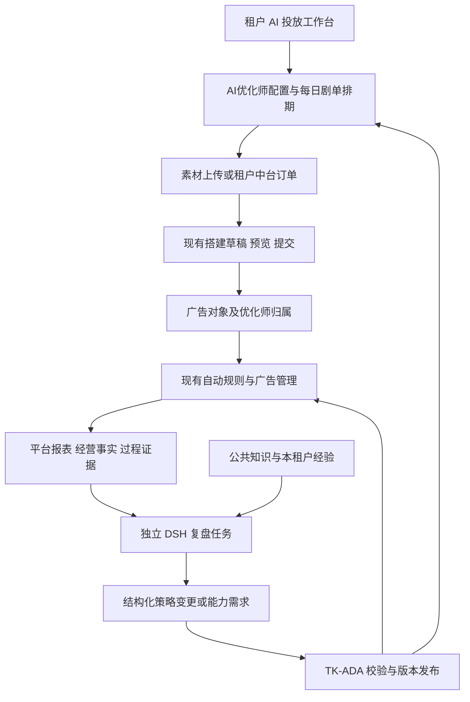

# TK-ADA 多租户 AI 投放工作台新版本设计草案

日期：2026-11-11；更新：2026-11-12。状态：已收敛为每个 AI 优化师绑定一条投放策略；简化版原型已回退到单策略版本并完成隔离浏览器检查，待用户体验反馈。用户已确认多优化师、自动优化/人工确认、独立一级入口、第二列 AI 侧栏、剧单预填搭建输入、执行时按剧匹配素材和按优化师账户范围监控。原型中的既有页面仍为入口示意，未挂载真实业务组件或接入真实服务；未实施产品代码、迁移或真实业务操作。

新版本把 AI 投放工作台作为 TK-ADA 的租户业务模块，复用现有素材、版权方、搭建、广告管理、报表和自动规则。DSH 使用独立运行进程承担复盘与策略优化，正式业务状态和所有执行能力均归 TK-ADA。现有本机 DSH 雏形保留，不直接扩为多租户生产系统。

## 1 用户需求与第一版边界

用户已明确：

- 每个租户有独立工作台，可创建多个 AI 优化师（租户 1:N AI 优化师）；每个优化师独立配置目标、一条投放策略、规则、计划、复盘版本、授权及 BC/账户范围，切换优化师不能混用状态。租户之间的数据、凭据、知识经验和 AI 会话隔离。
- 支持人工每日剧单、手动上传素材、按需向素材中台下单。人工与自动选剧使用同一排期；自动选剧能力完成开发和隔离验收，暂不向租户开放。
- 暂沿用日消耗、ROAS、目标优先关系；不增加新的经营目标体系。
- 创建 AI 优化师时，由用户选择或新建一条搭建结构投放策略、设置自动规则，并显式选择“自动优化”或“人工确认”模式。第一版初始策略由人设定，基于现状分析自动生成初版策略留作后续扩展。
- 剧和素材准备好后，定时调用 TK-ADA 现有搭建；投后动作交给现有自动规则，不再建设 AI 控损、放量、清退执行轮。预算、出价、启停等规则仍按现有能力执行；自动复制放量明确不在本期范围，后续单独新增。
- 复盘技能结合业务知识、上下文和历史经验，持续更新搭建策略与自动规则。
- 最新确认以显式优化模式为准：自动优化模式在预先授权范围内自动发布，越界形成待确认提案；人工确认模式下，所有 AI 建议的规则与策略调整（包括搭建策略）均须逐次人工采纳或不采纳，拒绝后当前生效版本不变。已有授权不能绕过人工确认模式。授权的字段、数值、账户与适用对象由租户配置，不继承本机个人历史授权；新增能力须先开发并校验。
- 所有动作都必须来自 TK-ADA 已实现的能力。缺少条件、指标或动作时登记开发需求，由开发者补齐后再进入配置与执行。
- 留存全过程业务事实、决策依据与实际结果。

第一版不迁移本机旧投放任务，不开放自动选剧，不实现自动复制放量，不自动生成初始整套策略，不开放任意脚本/SQL/原始 TikTok API 工具。聊天不是主要操作入口。执行日报保留为复盘与执行记录的按日视图，不另建一套计算口径。

## 2 架构方案评估

| 方案 | 收益 | 代价 | 结论 |
| --- | --- | --- | --- |
| 独立 DSH 工作台，通过 TK-ADA 开放 API 使用全部能力 | 便于未来跨产品员工平台复用 | 需要第二套登录和租户接入、机器授权、任务协议、事件与状态一致性；当前单用户文件状态不能直接复用 | 暂不作为产品主入口 |
| 在 TK-ADA API 或普通执行 Worker 内直接运行全部 AI 任务 | 接入路径短 | 长时间模型任务与既有同步、搭建、数据库连接竞争，难独立限制模型成本和故障 | 不采用 |
| TK-ADA 内置工作台与业务状态，DSH 独立运行，通过受控领域能力接入 | 复用租户、页面、权限和执行事实，AI 可独立伸缩；以后仍可开放外部工作台 | 新增任务级机器身份、复盘数据合同和版本发布服务 | TK-ADA 内嵌方向已确认；DSH 部署与接入细节为推荐方案 |

用户要求评估选型，因此本草案以第三种方案展开；这不是额外建立一套广告工具。前端和业务模块在 TK-ADA 仓库，DSH 接入按独立组件部署，不修改 DSH 核心。不要求每租户部署一套容器或 DSH 服务。

TK-ADA 是唯一业务事实来源，保存目标、排期、订单、策略、规则、授权、任务和复盘。DSH 只持有当前任务的输入、工具范围与模型会话，不直接写业务数据库，不持有版权方/素材中台/TikTok 凭据，不直连平台。业务接口继续走 TK-ADA 的既有 SDK/MCP 通道，不新增第三套 TikTok HTTP 网关。

## 3 已有能力与实际缺口

| 领域 | 源码已有 | 本轮需要补齐 |
| --- | --- | --- |
| 租户与授权 | 租户角色、BC 接入、账户范围、连接与绑定代数核验 | AI 优化师、知识、会话、调度、产物的同一隔离边界 |
| 版权方 | 六家适配器、租户加密凭据、按已知剧名搜索、候选消歧、推广链接准备及持久化 | 可分页的上新剧目目录、筛选与同步事实；不能把精确剧名搜索当完整剧单 |
| 素材中台 | 租户开户/绑定、加密公司 API Key、免密入口 | 当前中台公司凭据有效性核验、下单、订单状态、结果未知核对 |
| 成片交付 | 签名鉴权、幂等外部素材推送、异步入库与回执 | 订单项到排期行、剧目和租户素材的可靠关联；冻结目标 BC 和路由 |
| 手动素材 | 租户上传库、按剧名匹配候选、本次搭建人工素材分组 | 执行时复用既有搭建准备匹配素材、就绪条件与冻结交接；每日剧单不预选素材 |
| 搭建结构 | 不可变 StrategyVersion、草稿、冻结预览、幂等提交、逐步回读 | AI 优化师策略包引用、定时提交授权、排期行关联和对象归属 |
| 自动规则 | 条件/聚合/时区/频控/冲突检查、启停、预算与 ROAS 调整，走广告管理执行 | 优化师账户范围、不可变规则版本、两种优化模式的受控发布与任务版本边界；自动复制放量不纳入本轮 |
| 复盘数据 | 平台报表、经营口径、执行步骤、规则命中指标、动作台账和操作历史 | 跨模块关联、未命中证据、决策时点数据、长期留存、AI 分析与效果验证 |

当前放量继续通过已有预算/出价调整规则表达。自动复制放量是明确的后续能力，不进入本期开发阶段或验收；已有 campaign_copies 可供后续复用，届时另行设计自动规则接入、授权和频控/去重。第一版清退按暂停退出投放处理；删除、归档或移除素材不是当前已支持的自动规则动作，必须先开发能力，不能由 AI 临时绕行。

## 4 租户 AI 优化师与策略模型

AI 优化师是租户下明确的业务对象，租户与 AI 优化师为 1:N 关系。每个优化师有独立标识，分别保存名称、目标及目标版本、BC、显式账户范围、选剧模式、优化模式（自动优化/人工确认）、排期时区、单一投放策略引用、自动规则、每日计划、搭建/复盘安排、复盘记录及版本和授权；不把它实现为租户唯一的一组全局设置。第一版每个优化师使用一个明确 BC；租户需要不同 BC 时创建不同优化师，保留后续显式多 BC 扩展，不隐式合并。

工作台必须显式显示当前 AI 优化师并支持切换。目标、策略/规则编辑、计划筛选、复盘与版本、授权、运行状态和待处理提案均绑定当前优化师；切换后重新按租户与优化师标识读取，不能沿用上一个优化师的草稿、选中项、表单、任务结果或发布目标。服务端对每次读取、保存、调度和发布都校验该归属，不能仅依赖前端筛选。

业务上的完整策略包分层保存：

| 部分 | 第一版来源与处理 |
| --- | --- |
| 选剧策略 | 人工剧单为正式入口；自动目录筛选与选择留存版本及理由，仅隔离内部验收 |
| 素材策略 | 是否下单、租户可用的剪辑策略版本、数量及素材就绪条件，由人设定；具体素材在执行准备时匹配 |
| 搭建策略 | 复用现有投放策略编辑器和 StrategyVersion，用户选择或新建 |
| 控损/放量/清退策略 | 用 TK-ADA 支持的自动规则表达，用户设定初版 |
| 优化授权 | 可调整字段/幅度、预算边界、对象范围、发布频率、观察窗口与停止条件，由租户管理员授予 |

策略包版本引用各部分的不可变版本，并记录目标版本、优化模式、授权版本、创建来源和生效时间。推荐复用现有投放策略与自动规则实体及编辑器：优化师保存实体/版本引用，工作台提供入口与上下文，不建立第二套配置表单或影子状态。需要优化师专属配置时，在既有模块创建有明确归属的实体，其版本与历史仍可在原模块查询；不在选择已有实体时默认静默复制。发布前展示所有引用方与影响；共享实体不能借一个优化师的授权修改其他使用方，跨引用方影响未获授权时阻止发布，先通过既有模块显式建立专属配置再绑定。该复用与共享处理方案属于待确认建议。

自动规则最终作用范围为：租户当前授权 ∩ 优化师已分配的 BC/账户范围 ∩ 规则条件，并在执行时重新校验。规则监控包含该账户范围内符合条件的其他广告，不以“本优化师搭建产物”作为硬性过滤。搭建实际创建回执中的优化师归属继续用于追溯与归因，不代替规则作用范围。多个优化师账户重叠、与现有规则重叠时，展示重叠账户及潜在动作冲突，沿用现有规则引擎的冲突处理与频控；不另建独立执行链，也不自动禁用历史规则。

## 5 每日剧单与素材准备

每日剧单参考现有 ManualLinksDialog 与 dramaGrid.ts 的 Excel 式网格，支持粘贴多行、批量编辑和按日期筛选。预填内容限于搭建输入：剧名、计划日期/时间、版权方/应用、推广链接，以及是否下单素材；可预填已有剧目 ID，空缺时由解析结果保存；ID 按字符串保留前导零。当前优化师与搭建策略引用由页面上下文展示。BC 与账户完全继承优化师分配范围，剧单不另设账户选择或行级账户覆盖。此时不选择具体素材，也不显示“已选 6 条”等尚未发生的匹配结果；订单、就绪和执行结果作为后续状态显示。

剧名用于展示；版权方连接、应用与外部剧目 ID 用于稳定识别。人工输入从现有搜索取链流程解析，歧义需选择候选。人工推广链接沿用现有接口，不猜测小程序或外部 ID。

两条素材路径汇入同一排期行：

- 未勾选下单：使用租户已有或后续手动上传的素材；执行时调用既有搭建准备，按剧匹配素材。没有素材时保持等待，不能自动转下单。
- 勾选下单：按排期行及需求修订提交一份明确订单，保存租户绑定、不可变需求、稳定幂等键与外部订单 ID。超时/结果未知先查单，不重新下单。已有人工素材仍可供执行时匹配，但不会静默取消已受理订单。

上传本身继续不绑定剧目；仅在实际搭建准备、预览冻结后保存排期发生记录与匹配素材的证据关系，同一租户素材可服务多个计划行。成片交付必须通过订单/订单项与排期行关联，文件名只作匹配候选。现有外部推送合同需要版本化扩展，不能在 extra=forbid 的旧合同中静默添加字段。订单冻结明确 BC、入库/分发目标及连接，不沿用当前推送的默认 BC 推断来替代。

中台每租户的任务 API 可用性单独核验；免密登录成功、binding 为 ready 或持有旧中台 Key 均不能代表可下单。下单、查单、策略目录、交付关联及取消能力以当前中台正式接口为准，开发时先核验合同，不猜 URL，不复用本机个人默认值。未提供取消能力时，取消排期只阻止后续搭建，远程订单状态继续如实展示。

自动选剧与手动选剧都产出上述排期行。自动选择模块保留候选、排除理由、规则版本和来源时间；未开放租户在保存 AUTO、调用选择接口及后台调度三个入口都被服务端拒绝，仅隐藏菜单不算关闭。

内部首版选剧合同建议由人配置版权方/应用、上新日期区间、语言、可投状态及每日数量上限；按上新时间与稳定 ID 确定顺序，在租户与目标 BC 内排除同版权方应用/外部剧目已投及已排期记录。复测必须显式开启并有独立发生记录。缺少必需目录字段时报告不支持，不能猜值通过筛选。复用本机方法与固定样本，不继承新骏伯的具体阈值、额度、素材策略或个人授权；内容语义打分与复杂选剧实验不纳入首版内部验收。

## 6 定时搭建与投后执行

新增每日排期/发生记录，复用 Beat、持久派发和已有搭建服务。广告的开始/结束时间沿用 DeliveryConfig；它与“何时创建搭建任务”分别保存。

流程为：到期检查 → 解析链接并继承优化师账户范围 → 调用既有搭建准备按剧匹配素材 → 冻结搭建策略与实际素材快照 → 生成现有预览 → 校验授权与预算 → 提交现有搭建 → 处理真实结果/回读 → 登记对象归属。自动规则按优化师分配账户与规则条件持续监控，不以本次搭建完成或登记归属为纳管前提。

在用户已明确授予的定时搭建范围内，后端生成具体冻结预览并自动提交，仍完整通过现有提交校验；不另设每次人工审批。未授权或越界时留下可审阅预览。遵循 TK-ADA 现行创建 ENABLE 合同，不搬入雏形的“停用创建后再批准开启”。所有剧投向优化师已分配且当前授权有效的全部账户，不添加账户轮转。优化模式控制 AI 配置变更是否需要人工采纳；定时搭建及既有规则执行仍按各自已获授权运行，不把人工确认模式解释为逐条平台动作审批。

稳定排期发生记录只创建一次，与草稿/预览/提交关联；重启、重复投递和结果未知按同一发生记录与任务续接。排期修订不自动成为新的广告搭建许可，若已受理或部分创建需先核对原结果；需要再投时显式新增发生记录。按 BC、版权方应用、策略及路由兼容性分组复用草稿，不能把任意计划行强塞进一个草稿。

素材未就绪时等待至行级截止时间，首次建议默认排期时区当天结束；截止后标记错过，不跨日补跑。用户可重新排期。搭建部分成功保留逐账户状态，未知先核对，不能重建整行。

本期投后动作使用现有自动规则与广告管理支持的预算、出价和启停能力。自动复制放量后续单独设计与实现，本期不提供自动复制规则配置、调度或验收。平台数据或素材身份未就绪时显示等待/跳过，不承诺搭建后立即获得所有规则所需指标。

## 7 复盘与按模式发布循环

复盘按租户与 AI 优化师分别生成任务和版本，输入、提案、发布与效果验证均保留优化师归属；一个优化师的复盘不能修改另一个优化师的目标、策略、规则或授权。复盘输入由 TK-ADA 生成：目标与优先级、策略/规则版本、排期兑现、素材与链接状态、搭建事实、规则候选/命中/未命中/动作结果、报表覆盖与新鲜度、账户当地完整日、人工干预及授权范围。经营数值复用现有报表和 business 计算，币种不同不直接相加，AI 不另算一套费率或赔付口径。

根目录知识和现有复盘 skills 按来源整理为版本化资产，区分公共行业知识、本租户经验和历史特定 BC 案例。记录适用范围、有效期、来源和证据。现有 skill 中的固定 BC、个人授权、文件账本及旧执行命令必须适配为当前任务输入和 TK-ADA 能力，不能照搬到多租户。原始 outputs 与私有业务经验不自动进入其他租户检索。

DSH 复盘任务输出目标差距、执行偏差、证据引用、候选变更、预期与验证条件；允许“证据不足/本轮不调整”。产物限为 TK-ADA 可校验的结构化配置或能力需求，不能是可执行脚本。执行成功与经营改善分别判断；同时发生的人工改动、规则干预和归因延迟必须解释，不能把前后波动直接归因于 AI。

发布服务执行能力目录/Schema、当前优化模式、授权、版本并发与影响范围校验。自动优化模式在明确授权范围内自动发布新策略包，越界形成待确认提案。人工确认模式下，所有 AI 建议的调整（含搭建策略与各类自动规则）均进入“待确认”，展示变更前后值、依据、影响账户/对象与版本；用户逐次选择“采纳”或“不采纳”。采纳时重新核验权限、范围与当前基线版本，成功后才发布；拒绝只记录决定与理由，当前生效版本保持不变。待确认或被拒绝的提案不能在下一轮自动生效，也不能以已存在的自动授权绕过确认。模式切换不得自动采纳已待确认的提案。TK-ADA 不支持的指标、条件或动作形成能力需求，原策略继续有效。第一版不允许 AI 自行扩大账户、修改优化模式/授权、启用未开放自动选剧或执行代码开发。

版本生效语义：

1. 已冻结或已提交搭建保留原快照，新搭建使用当前发布版本。
2. 新自动规则版本在发布时切换优化师当前规则集，后续新运行使用新版；旧的尚未提交平台动作进入失效/重判，不能在新旧版本间混用定义。
3. 已提交的广告管理动作继续按原冻结任务核对，结果未知先恢复，不重发。租户暂停、撤权与版本变更的状态分开，不用改版本重置频控或“仅一次”计数。
4. 新版规则可作用于优化师账户范围内符合条件的在投对象，包括其他来源广告；最终范围始终取租户授权、优化师账户范围与规则条件交集。发布记录分别列出未来搭建和既有对象影响，并标明重叠优化师/规则。
5. 回退通过发布引用旧配置的新版本完成，不篡改历史，不撤销已经发生的平台事实。

自动发布记录操作者为 AI 服务主体、授权人、原始提案、校验结论及精确生效时间；人工采纳发布同时记录提案来源与实际采纳人，拒绝记录单独保留。授权人失效、租户停用或能力撤销立即阻止新的执行与发布。普通成员不能借 AI 获得管理员的自动规则权限。

### 7.1 2026-11-13 确认：统一复盘 Skill 与专项方法

用户确认采用一个主复盘 Skill、一个工作台入口，内部按任务加载搭建与测新、自动规则、素材和经营专项参考方法。无需分别触发五个复盘或默认拆为多个 Agent。保留原本机整体/控损/测新/放量/跟投 Skill，从中提炼通用方法；其 BC、固定阈值、个人授权、本地账本命令和旧审批流程不迁作多租户默认配置。放量/跟投方法留作后续扩展，v1 的单策略、无复制放量/跨 BC 执行/多方案/A/B 边界不变。

固定复盘数据包须由 TK-ADA 主动组装，不依赖发起人已有查询快照。指标、完整日、成熟窗口、成本和候选回放使用共用确定性计算；模型读取实际主 Skill/专项方法与知识正文，负责证据解释、假设和建议。任务冻结方法与知识的版本、哈希及实际内容，避免仅有引用元数据。

知识按公共方法、租户经验、BC 案例隔离。形成原问题→建议→决定/执行→版本与时间→成熟结果→下一轮验证闭环；模型提炼经验先记候选，不能未经验证就当成事实或公共经验。缺数据/知识/映射须写明能力限制，允许证据不足、不调整及补数据请求。

当前插件内嵌通用提示词、已有快照与知识元数据结构不满足上述业务复盘交付标准。此前“v1补完”限于已有代码、协议和页面范围；这些补充能力尚未实施，按[专项计划](../plans/2026-11-13-ai-review-methods-and-learning.md)逐阶段验证。

## 8 能力合同与开发者补能力

DSH 接入只暴露有限领域工具，例如获取复盘数据、检索本租户知识、读取能力目录、提交策略提案和登记能力需求。常规下单/搭建/规则执行由 TK-ADA 后台驱动，无需模型逐步指挥原始 API。

每次 AI 任务有 tenant、优化师、BC/账户、输入证据集、允许操作、有效期、预算、模型/skill 版本及任务会话。采用专用服务身份与任务级授权，租约/取消/重启后旧任务不能迟到发布；不复用浏览器登录 token 或素材推送集成 Key。领域 API 和 UI 调用同一业务服务，不直接暴露内部 Celery 队列。

模型接入建议第一版由平台统一配置服务，租户无需各自配置 DSH 登录；模型凭据只属于平台运行服务，不进入租户输入或工具结果。每租户独立计量费用/用量、限制并发，同一优化师内的复盘串行；DSH 会话、任务目录与检索范围隔离，等待模型时不持有数据库事务、不占用搭建/报表执行队列。租户自带模型凭据留作后续扩展。

能力目录声明支持的条件组合、指标、数据窗口、层级、动作、参数边界和兼容版本。需求缺口保存期望行为、输入/输出、业务证据、当前失败项、验收样例及关联提案。开发者实现并测试、发布能力版本后，重新验证原提案，再按原授权决定生效；开发完成本身不意味着新增动作已获租户授权。

## 9 过程数据与证据留存

建议新增业务实体组，实际表名由实施阶段确定：

| 实体 | 职责 |
| --- | --- |
| AI 优化师及配置/授权版本 | 租户 1:N 优化师；分别保存目标、范围、优化模式、既有策略/规则引用、计划、复盘、授权、定时与当前版本 |
| 每日计划/计划行/发生记录 | 人工或自动来源、修订、排期兑现及唯一搭建交接 |
| 剧目目录/选择运行 | 版权方事实、同步来源、入选与排除依据 |
| 素材订单/订单项/交付关联 | 外部请求和结果、排期行、入库素材及未知结果核对 |
| 优化师对象归属 | 本期搭建批次、账户/BC、远端对象和归属来源；自动复制关联留作后续 |
| 不可变规则版本/策略包发布 | 基于既有实体扩展版本与引用，保存影响范围、生效时间、频控身份及回退关系；不建平行配置源 |
| 决策证据集/复盘/提案/能力需求 | 当时输入、分析产物、知识版本、发布与后续验证 |

每个记录贯穿 tenant、AI 优化师、plan_item/occurrence、strategy_bundle、submission、rule_run、management_task、review/proposal 等关联标识；现有源码若使用 trader 等技术名称，可保留引用，但产品业务对象统一称 AI 优化师。使用现有实体引用，不复制另一套广告事实。

至少记录候选/未命中原因、计划/实际动作、前后值、请求摘要、受理/成功/失败/未知、回读证据、人工干预、DSH 工具事件、模型/skill/知识版本、提案批准或拒绝及效果窗口。模型日志限可见工具事件与输出，不要求保存内部思维链，不记录凭据。

现有规则运行 30 天清理、规则级联删除、报表桶覆盖以及短期查询快照不足以支撑长期学习。保存被决策引用的最小不可变证据集，包含 observed_at、统计日期/时区、来源版本、覆盖、新鲜度、指标及必要候选行；对相关经营结果做引用保留或导出。精简证据存储不等于全量复制报表库或历史视频。保留策略需使引用仍有效，清理不能静默切断复盘来源。

无法取得当时可见数据的旧历史，只能用于事后分析/模拟，不能标成无信息泄漏回测。日报使用同一条证据链汇总今日排期兑现、素材、搭建、规则动作、目标达成、优化变化和待处理事项，并区分运营日与各账户统计日。

## 10 分阶段交付与验收

这是跨版权方、素材、搭建、规则、AI 与数据的多阶段项目，不能按“给现有 DSH 页面加几个功能”估算。先完成可运行的人工排期链路，再接入优化；证据关联从第一阶段开始，不能最后补记。

| 阶段 | 交付内容 | 主要验收 |
| --- | --- | --- |
| 1 基础与人工排期 | 租户 AI 优化师、优化模式、现有目标、BC/账户、人工初始策略/规则引用、Excel 式剧单输入、对象归属、证据基础 | 两租户不串数据；多个优化师的配置、计划和授权独立，切换不混状态；剧单不提前选素材，账户仅继承优化师；原模块可查策略/规则；无权和未开放 AUTO 接口拒绝 |
| 2 定时执行与纳管 | 定时发生记录、既有搭建准备匹配、预览/授权提交、回读、账户级规则范围、不可变规则版本 | 执行时按剧匹配素材；重启/重复投递不重复搭建；部分/未知按原任务续接；规则覆盖授权账户内符合条件的其他广告；多优化师重叠可见且复用冲突处理；版本切换不混用 |
| 3 版权方目录与素材订单 | 全目录合同、租户订单、回传关联与到片就绪；自动选剧完成隔离内部验收但不开放 | 各适配器真实支持范围分别标注；重复回传不重复入库/搭建；错租户/错订单/错 BC 拒绝；登录 ready 不冒充可下单 |
| 4 DSH 复盘与受控优化 | 知识分层、成熟数据复盘、结构化提案、按模式发布、待确认、日报、能力需求 | 各优化师的复盘/版本/提案独立；自动模式仅授权内发布；人工模式含搭建策略的每次建议均待确认，拒绝不改版本，采纳重新校验；模式切换不自动采纳旧提案；未知能力登记需求；旧知识/脏数据/未执行不伪装策略失败 |
| 5 长期证据与完整验收 | 长期证据保留、端到端观察 | 隔离链路和真实租户联调分开；真实连续执行/日报/复盘/新版本后续使用均有证据，不以样本代替实盘 |

版权方和中台可按阶段接口并行开发；自动复制放量不属于上述任何阶段与本期验收。首个端到端人工链路不被全部版权方覆盖或自动选剧开放阻塞。真实下单、广告动作和部署仍按具体租户/资产授权执行，本设计确认不代表立即运行真实业务。

## 11 已确认范围与实施前产品取舍

用户已确认：产品业务对象为 AI 优化师，一个租户可创建多个，每个独立配置目标、规则与 BC/账户等范围；创建时显式选择自动优化或人工确认，人工模式下包括搭建策略在内的所有 AI 调整逐次采纳或不采纳，拒绝不改现版本；每日剧单采用既有 Excel 式输入体验，预填剧名、时间、版权方、链接及是否下单，执行时复用搭建准备按剧匹配素材，账户只继承优化师分配范围；规则按分配账户范围监控，包括该范围内其他广告。工作台嵌入 TK-ADA；自动复制放量后续新增，不在本期范围，现有预算/出价等规则能力继续使用。

草案采用以下建议默认值，需随设计一并确认：第一版每优化师单 BC；清退先指暂停；缺素材等到行级截止、过期不跨日补跑。在 TKADA 最左菜单中“打开体验版”正上方新增独立“AI 投放工作台”入口，进入后使用第二列 AI 侧栏，优化师、每日剧单、执行、复盘、待确认作为工作台页面，保留原素材、搭建、投放策略、自动规则菜单；策略/规则复用既有编辑器与实体，优化师仅绑定引用，专属配置与历史版本在原模块可查，无第二套表单或影子状态。授权具体上下限在租户创建优化师时填写，不由开发者替业务确定。

另外建议采用平台统一模型服务及上述确定性内部选剧合同。它们是本次评估提出的实现取舍，不作为用户已确认的原始要求。简化版原型已完成隔离浏览器检查；此前多方案版本的浏览器检查仅代表当时原型。

中台当前任务/交付接口是阶段 3 的外部合同依赖，应先取得当前正式定义和联调租户；不要求用户重新提供 TK-ADA 已保存的凭据，也不读取历史明文文件来填补。

## 12 源码依据

本次依据当前源码，不把源码存在视为任意生产租户已配置或完成真实联调。

- [租户权限](../../../backend/app/modules/tenants/permissions.py)、[BC/授权路由](../../../backend/app/modules/accounts/routing.py)。
- [版权方合同](../../../backend/app/modules/providers/adapters/contract.py)、[剧目与链接模型](../../../backend/app/modules/providers/models.py)、[搜索取链入口](../../../backend/app/modules/providers/router.py)。
- [素材中台绑定](../../../backend/app/modules/material_production/models.py)、[中台客户端](../../../backend/app/modules/material_production/client.py)、[现行集成边界](../../integrations/material-production.md)。
- [成片推送合同](../../../backend/app/modules/materials/push_schemas.py)、[推送入库](../../../backend/app/modules/materials/push_service.py)、[素材分组及搭建准备](../../../backend/app/modules/builds/drafts.py)。
- [每日剧单网格参考](../../../frontend/src/features/builds/DramaInputSheet.tsx)、[手动链接输入参考](../../../frontend/src/features/builds/ManualLinksDialog.tsx)。
- [结构策略版本](../../../backend/app/modules/strategies/models.py)、[预览冻结](../../../backend/app/modules/builds/preview_models.py)、[提交与幂等](../../../backend/app/modules/builds/submissions.py)、[执行证据](../../../backend/app/modules/builds/execution_models.py)。
- [自动规则条件与动作](../../../backend/app/modules/automation_rules/schemas.py)、[规则版本及台账现状](../../../backend/app/modules/automation_rules/models.py)、[运行/保留现状](../../../backend/app/modules/automation_rules/tasks.py)、[规则动作执行](../../../backend/app/modules/automation_rules/executor.py)、[复制能力](../../../backend/app/modules/campaign_copies/api.py)。
- [查询快照生命周期](../../../backend/app/modules/reporting/query_models.py)、[报表发布](../../../backend/app/modules/reporting/publish.py)、[经营计算与证据](../../../backend/app/modules/business/models.py)、[经营数据清理](../../../backend/app/modules/business/maintenance.py)。
- [现有 DSH 雏形](../../../../deepseek-ads-workspace/README.md)、[业务知识目录](../../../../../docs/README.md)、[员工复盘方法](../../../../../.codex/skills/ads-employee-review/SKILL.md)。
