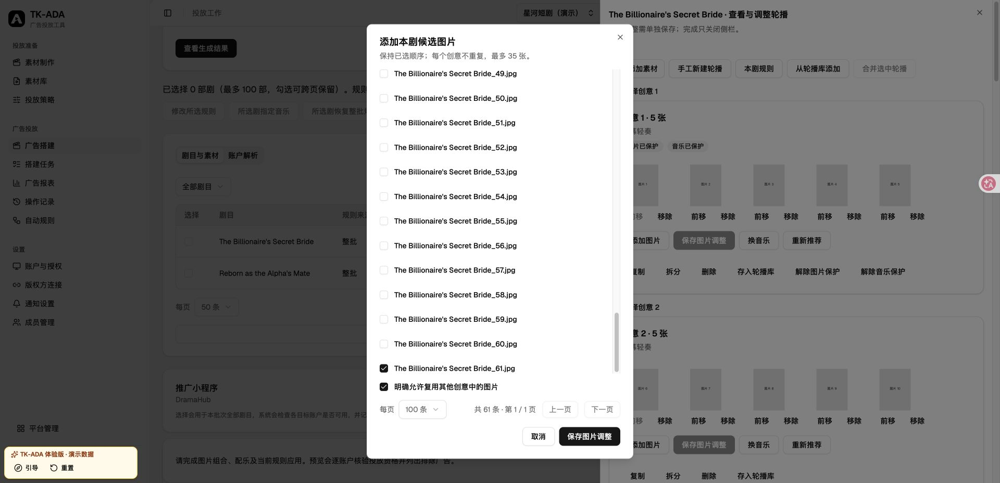
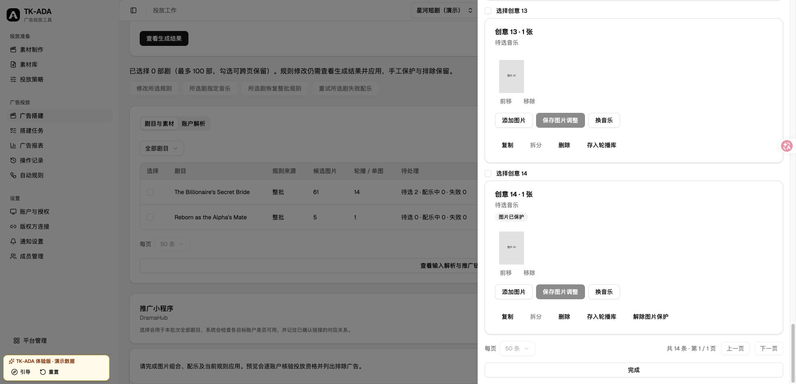
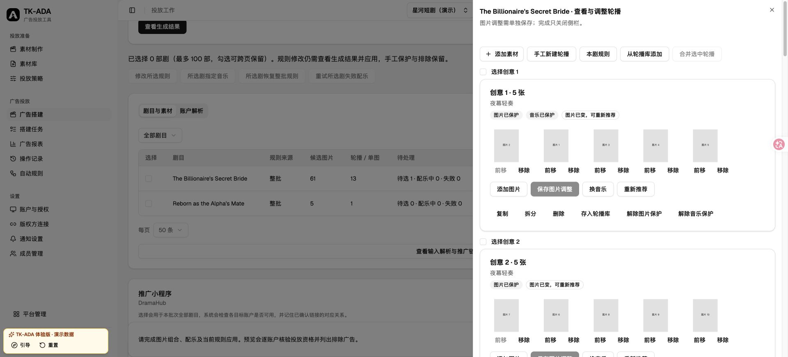

# 图片批次本地验收与待发布清单

记录日期：2026-10-30。范围为本地集成与未来验收方案。未调用真实 TikTok/R2，未选择真实 BC、连接或账户，未部署、推送、备份或恢复线上数据。合成演示、传输替身和真实平台验收分开记录。

## 当前合同与本地证据

新预览使用 V2。0059 将可编辑视频草稿迁为有序单元；0060 附加明确 V1 合同和历史布局；当前 head 为0061。旧冻结正文、哈希和原请求身份不改写。旧预览可因草稿版本提升转 OBSOLETE，这不等于改写正文。

未提交 V1 仅历史查看，新提交返回 preview_contract_expired。已有 request_id 和同预览新别名均返回原提交，不增加执行任务。未变草稿复用锁内 revision 提升生成唯一 V2；丢失响应重放返回同一个新预览且不重复排队。

所有本地 PG 升级使用 historical_database 的随机 migration_*_test 库，仅清理该夹具；共享库不降级。Redis 显式使用本地 DB14，不 FLUSH。

| 检查 | 结果与边界 |
| --- | --- |
| test_creative_unit_upgrade.py + test_video_unit_migration.py | 6 passed；新提交阻断、已有提交重放、重生成唯一性、真实0059→0061旧/混合历史guard、未知head拒绝、0058→0059视频草稿可编辑 |
| python3 scripts/test-release-tools.py | 53 passed；显式迁移guard失败先于snapshot/迁移，复查可通过；普通发布/备份行为保留 |
| workspace image-delivery + build-preview | 49 passed；40图上传完成、规则/单图音乐、V2分页、UNKNOWN核查、广告级轮播报表；全程无真实API请求 |
| scripts/generate-client.sh 后 frontend build | 官方客户端串行生成，生产与demo构建通过；既有构建警告如实保留 |

后续定向回归、E2E及静态门禁输出见 T5 实施报告及根代理的全分支复核。合成通过不证明平台格式资格。旧库夹具保留 UNKNOWN 原正文/digest，升级后仍阻断；这是混合历史失败关闭验证，不是允许生产绕过排空。未执行 downgrade，不能在产生 V2 数据后承诺数据库回退。

## 操作路径与合成演示

素材库“批量上传”选择静态 JPG/JPEG、PNG。上传40张图片与单轮播最多35图是不同边界；20 MiB、1600万像素是本服务准入，不是平台硬限制结论。

图片批次“准备与调整”顶部“整批图片规则”设置单图/顺序轮播、N张、排序、余数及配乐。先“查看生成结果”核对新增、保留、替换和保护损失，再“应用并生成”；默认保留手工保护，不自动清空排除项。组合或音乐未就绪不能预览。

剧目行“查看与调整轮播”打开侧栏，图片修改点“保存图片调整”；“换音乐”后搜索、选曲、“使用这首音乐”。完成后核对待选归零。图片和音乐分别保护；所选剧批量操作确认范围。“本次广告结构”只影响当前草稿，“投放策略”保存可复用结构。N图片/单元、M单元/基础广告、K文案版本不可混淆。

本地入口 /demo/#/login → “自由体验”。固定草稿为 /tenants/d0d0d0d0-0000-4000-8000-000000000065/build-drafts/d0d0d0d0-0000-4000-8000-0000000002d3?bc_id=7400000000000000101。全部租户、BC、账户、图片、曲目均虚构。

合成场景限定1共享组、M6、K1，不另复制后端策略引擎；其他结构明确显示演示范围错误。首剧61图13单元（末单图待选音乐），次剧5图1单元，两账户合计8广告。规则采用后，首剧第13单元选“晨光序曲”，完成→生成搭建预览。预览“账户组合”→“查看冻结详情”→展开第1组→按广告分页核对完整图片顺序和音乐。

新图片预览保持 PREPARING + carousel_music_unverified，可提交但目标账户原曲目须在发送前核验；预览不声称已核验音乐。正式产品提交具体预览后直接三层 ENABLE，无第二次激活流程。演示第一组合模拟远端创建成功但响应丢失，仅提供“核查待核实项”；核查读回同一对象，不重复创建。报表仅显示广告级模拟金额及有序图片/音乐，不分摊图片或轮播单元金额，不支持图片素材级自动规则。刷新页面重置合成状态。

## 待审查的上线切换方案（未执行）

1. 明确目标环境、精确旧/新 SHA、migration heads、租户/BC、四个现有开关、额度与并发。按2026-10-29规则，默认合同变更在停服前停止，不自动全备；只有另行明确选择才用 --full-backup。本轮没有线上备份/恢复证据。
2. 停止新入口和生产者，让旧消费者正常完成；先用只读 creative-unit-drain 检查。积压仍在则保留队列，按旧部署恢复消费者继续排空；UNKNOWN 按原意图核查，不强行失败、不清队列。
3. 锁与冻结窗口内再次检查并留存结果，全部通过才迁移。release 显式完整迁移候选含0060时，guard位于 pause 之后、snapshot/迁移之前；普通代码发布、backup、backup-online不新增旧合同排空。无备份迁移方案需单独审查，复用同一guard，不偷换为自动全备。
4. 迁移前失败可依现有 recover 正常恢复旧部署并复查；迁移开始后禁止自动启动旧程序或盲目降级，保留现场选择前进修复。不得用清卷/清队列替代恢复。
5. 核对 API、各 Worker、Beat 实际开关/额度与原选择一致。图片准入、轮播规则、预算和并发都是参数，不新增部署开关。
6. T4 历史数据审计：按目标租户/账户只读列出 material_post_link.main_material_type 的 distinct值/行数并核对广告金额。历史可含 VIDEO_NON_SPARK_ADS / VIDEO_SPARK_ADS 等原始类型；未知类型保留关系与广告金额，不能猜成VID或自动规则输入。本轮未线上查询，不声称历史均为规范VIDEO。

### 只读排空探测

旧应用辅助容器可通过stdin接收候选 deploy/release/probe.py 并运行 python - creative-unit-drain，复用现有release helper配置；不导入新ORM。人工执行同脚本必须检查输出 drained=true，不能只看退出码。

已知0060前head显式归V1，0060/0061按descriptor分类；未知/多head、缺表/查询错误不放行，0060之后缺descriptor单独阻断。每类最多返回一个ID样本，不输出正文或凭据：

- V1 BUILDING预览，包括尚无Submission的生成/续步任务；终态预览迟到消息由状态/代数守卫no-op。
- V1 Submission未expanded，或不在COMPLETED/PARTIAL/FAILED（含QUEUED/RUNNING/NEEDS_REVIEW）。
- V1 ExecutionStep为QUEUED/PENDING/RUNNING/RETRYABLE/UNKNOWN，即使父提交被标终态仍阻断。
- V2工作不计入V1阻断，进程退出与既有锁/队列保护仍独立保留。

## 真实平台验收待授权清单

状态：BLOCKED / UNVERIFIED。真实BC、官方SDK连接、身份、Minis、源/目标账户、图片摘要、音乐、币种和日预算均未选择，不沿用历史默认。当前功能只用官方SDK，不扩展退役MCP。

先形成具体ID、文件摘要、金额和对象名称清单，再取得仅限本次远端创建的明确授权：

| 用例 | 输入 | 必需回读 |
| --- | --- | --- |
| 单图单元 | 1张静态图片、明确曲目、1目标账户 | 源MID、目标image_id、音乐/顺序一致 |
| 三图轮播 | 3张有序图片、明确曲目 | 完整三图顺序，不缺图缩减 |
| 同一Ad两个单元 | 两个各3图单元，可同图不同曲 | 两单元及各自音乐可区分，不去重/拆分；不支持就记录不支持 |
| 第二目标账户共享 | 明确源和第二目标账户 | 各账户独立image_id映射与原始归属证据，不假设源目标ID相同 |

独立外部验收的Campaign、AdGroup、Ad均DISABLE，逐层回读所有父子对象为DISABLE，保存请求摘要/远端ID/响应证据；精确预算未填不得执行。此为另行授权的停用验收结构，不改变产品提交ENABLE，也不新增激活流程。

35图当前仅有本地合同/传输测试；上传40图只证明入口边界分离，不能宣称平台接受35图。真实35图、SDK接受、平台校验、回读完整各自记录。审核、音乐播放、滑动展示、价值优化与投入效果需另行具体启用/花费授权，明确对象、预算、时间窗和停用条件。停用创建成功不足以完成这些验收；未核实场景格式资格时生产继续阻断，不能用合成数据绕过。

## Computer Use 最终本地核验（2026-10-30）

使用最终静态演示构建（localhost:5186），整批规则应用后生成14个单元，为第一部剧尾部第13个单图选择“晨光序曲”；预览得到4个系列、4个广告组、8条广告，目标音乐显示提交后核验。冻结详情按2条广告分页，第二页保留单图及原选音乐。模拟提交的同一任务B830392从7/8广告待核实，经“核查待核实项”变为8/8；广告报表展示有序图片、原选音乐、广告级金额边界和素材自动规则限制，冻结链接回到原任务。

这是合成数据和模拟执行，未连接真实BC或平台写入。开发热更新/跨构建旧页面引起的会话重置不计入最终验收；最终稳定构建完整链路通过。

最终全局 `ruff check app tests`、`ty check app` 通过。全局格式检查仍有58个既有文件待格式化，同工具主分支基线为70个；本功能新增格式问题已处理，不声称全局格式全绿。此前聚合运行出现一次失败的场景恢复用例，本次定向1项通过，原聚合记录保持原结果。

## 总审查修复定向验收（2026-10-30）

总审查发现的原件清理后缩略图不可见、未应用本地规则仍可预览及演示夹具循环初始化，统一完成一轮修复。缩略图在原件不可读或 URL 失效时，仅回退到当前草稿 BC 的已授权平台图片；平台失败显示不可用，不触发上传。

最后一轮图片编排与交付浏览器回归24项通过（含8项新增回归），图片预览 PG/SDK 9项及既有视频/跨BC预览5项通过。生产与演示构建、官方客户端生成、聚焦 Ruff/ty、Bun独立导入通过；沿用前述既有格式/测试类型检查警告，不声明全套检查全绿。

Computer Use 单独验证：音乐全部就绪时可预览；整批 N 从5改3后按钮禁用；只查看差异再返回仍禁用；应用并等待读回完成后恢复；逐剧 N 改4并关闭侧栏后再次禁用。截图为最后一步。原件清理、URL失效及授权撤销由浏览器请求替身和真实PG授权测试覆盖，未以CUA伪造清理，也未访问真实平台。

修复提交07ca7837的定向复审结论：全部3项ADDRESSED，未发现新增问题，可合并本地main。随后整合main 1f4a01fb（查询预算嵌套恢复）至4470a787；`TEST_REDIS_URL=redis://localhost:6379/14 uv run pytest tests/modules/reporting/test_nested_query_budget.py tests/modules/reporting/test_carousel_ad_links.py tests/modules/reporting/test_planning_commits.py tests/modules/reporting/test_material_links.py -q` 结果 **73 passed / 33.42s**。该整合没有改变已验收的界面和缩略图代码。

最终合并前main又新增cfc7baff健康探测日期收窄，已合入。初次整合33通过/1失败：结果与参考SQL一致，性能断言把EXPLAIN每循环取整均值3乘1000当作精确3000行，超过理论2668行。实际计划为主键Index Scan、512/488次、日期条件位于Index Cond、无Filter。仅给测试增加每次半行取整容差；34项回归通过（5.48s），Ruff通过。独立进程将查询改回“各账户固定读两天但保留原返回值”作负向探针，仍在同一性能断言失败（4000 > 3168），证明没有放过原扫描回退。原失败和探针日志保留，不改生产查询。此为main整合测试校正，不是第二轮轮播功能修复。

## 第二轮独立 Review 五项修复（2026-10-30）

修复提交 `05f92381`。以本地 main `39632a5b` 为基准，在保留的 `feat/image-carousel-batch` 工作树修复；没有新增迁移、任务合同或部署开关。

| 原问题 | 修复与回归 |
| --- | --- |
| 过期图片编辑可借添加弹窗覆盖新顺序 | 卡片、弹窗固定编辑开始时的草稿版本；过期添加禁用，服务端 CAS 拦截轮询前的并发。恢复候选仅采用自身成功 CAS 的返回版本。 |
| 配乐撤权后任务失败但单元一直等待/运行 | 已持有草稿与任务锁时仅写匹配单元的本地失败状态；沿用代次、内容、请求和手选保护，每片最多20项；恢复权限后可重试。 |
| 复制创意不能重排或删减 | 保留已明确建立的复用关系；新增与其他创意的图片交集仍要求确认。 |
| 50条候选把弹窗撑出屏幕 | 弹窗限制为视口90%，候选列表内部滚动，复用确认与分页/保存保留在列表外。 |
| 切换每页100条不重新请求 | 候选、创意、差异与试算单元的查询键均包含页大小。 |

先运行失败回归：后端4项、前端5项均按预期复现原缺陷。最终验证：

- `TEST_REDIS_URL=redis://localhost:6379/14 uv run pytest tests/modules/builds/test_carousel_music.py tests/modules/builds/test_image_composition_service.py -q`：**66 passed / 110.58s**。真实PG、Redis，外部服务仅SDK传输层替身；涵盖22订阅者分片、撤权前后、新手选保护、单项/整批重试及新增复用确认。
- `PLAYWRIGHT_PORT=5193 bun run --cwd frontend test tests/image-composition.spec.ts tests/image-delivery.spec.ts --project=workspace --workers=1 --reporter=line`：**29 passed / 1.9m**。含720/929px视口、50/100候选、过期添加，以及既有模拟交付全链路。
- 增强既有恢复候选用例，继续点击保存并核对成功返回版本与已选图片；定向复测 **1 passed / 6.8s**，是上述29项之一，不重复计数。
- 正式版/演示版构建、修改后端文件的 Ruff 与 ty、差异空白检查通过。修改前端文件的格式化通过；Biome lint仍有卡片拖拽div缺少role的1项既有告警，不声明全局检查全绿。首次聚合后端命令引用不存在的独立batch测试文件，未运行测试；已使用实际两文件完整运行，batch行为在其中覆盖。
- 独立只读复核：五项闭环，未发现本轮新增阻断缺陷，可合并。没有运行真实平台写入，真实资格/投放/播放和生产发布仍不属于本次验证。

Computer Use使用重建后的localhost:5186演示：50条时底部控件可见；切换100条读取全部61条，选中第61张并明确复用后保存。截图仅为合成数据，非真实BC。

## 第三轮 Review 两项修复（2026-10-30）

修复提交 `9627376a`，基准 `1d1f1034`。连续编辑回归由前端固定旧草稿版本引入；配乐准备撤权遗留未入队单元是上游准备阶段的既有遗漏。无数据库/API字段或部署开关变化。

- 连续编辑：仅记录本页成功操作的单步版本回执，沿连续回执推进未受影响的卡片编辑版本。图片内容变更的单元不推进，外部版本缺口不跨越；支持请求重叠、回执乱序，局部版本保持单调。换曲、另一卡片保存，以及恢复候选后取消添加弹窗，均保留原图片调整。
- 准备恢复：保留失败准备记录。用户勾选剧目并确认批量重试后，在草稿锁内补接同租户/BC/当前代次、失败PREPARE游标之后的未保护PENDING单元，前提是没有完整匹配内容/规则/请求代数的音乐任务。复用现有入队，不增加音乐请求代数；每片20项。无失败前提和旧代失败不会触发补接；同代失败与新PREPARE并存时可以提前入队当前未启动单元，仍通过幂等入队避免重复。确认文案说明此恢复范围。

验证：

- 先跑真实失败：两条连续编辑浏览器用例在补上真实CAS校验和最终内容断言后失败；准备前与20项后撤权两条PG用例在“应补接但retried=0”失败。首次大夹具因原apply_rule辅助方法仅推进一次而停在PENDING，扩展测试辅助方法推进至终态后重跑，不能将夹具错误计为业务复现。
- `TEST_REDIS_URL=redis://localhost:6379/14 uv run pytest tests/modules/builds/test_carousel_music.py tests/modules/builds/test_image_composition_service.py tests/modules/builds/test_carousel_music_api.py -q`：**79 passed / 196.70s**。涵盖7/67图、20项分片、恢复至实际READY、新音乐请求/手选保护、无失败准备和旧代失败的排除。
- 图片编排及交付浏览器回归：**33 passed / 2.0m**。新增重叠请求先单独复现，再修复为连续回执链；最终9项定向通过。随后增强乱序用例：父摘要故意保留旧版本，再开始一轮新编辑；与外部跳号拒绝共2项 **passed / 6.5s**（是33项中的增强用例，不重复累计）。增强过程中一次测试门闩误阻塞第二次保存，修正为只阻塞首次回执后通过，业务代码未因此放宽。
- 正式/演示构建、聚焦Ruff与ty及差异检查通过。修改前端文件的Biome格式化通过；ImageDramaBatchActions已有div aria-label缺少role的lint告警保留，不声称全局lint通过。
- 独立复核无阻断；审查提到的乱序回执局部版本回退已由单调更新处理。未触发真实平台、未推送或部署。

集成主分支 `c17bb531`（小程序超时恢复、Worker队列配置）至 `3525abe4` 后，定向后端31项通过（72.53s，含原79项中的准备恢复），连续编辑/外部跳号浏览器5项通过（14.2s，含原33项），正式与演示构建通过。未改变并行任务的部署配置；本轮仅把已有main整合到工作树。

Computer Use使用最终静态演示：同时将第一、第二张卡片的第2图前移，先保存第二张，再保存第一张；两次均成功，关闭再打开侧栏后仍分别保持2/1/3/4/5与7/6/8/9/10顺序，无错误提示和未保存调整。截图为重新打开后的结果。首次在构建输出替换过程中打开旧页面出现404，待构建完成重新加载后验收；未将该中间状态作为产品缺陷或成功证据。

## 第四轮 Review 修复（2026-10-30）

修复提交 `bb5a3513`，基准 `e0b85952`。main 新增的 Worker 部署配置回退已快进同步，本轮不修改部署文件。

- 复制正在配乐的轮播会继承 RUNNING，但副本仍需准备阶段添加任务订阅。准备失败后，批量重试现在同时检查 PENDING/RUNNING 中无完整匹配任务的单元；保留失败准备证据、当前代数、租户/BC、音乐意图与手选保护判断。
- 明确补接副本时，如果匹配到旧的已失败任务，不能再次发布其失败缓存：只为新增订阅清除失败结果、错误及尝试/等待预算，保留已发布游标。运行中任务不重启，成功缓存不丢弃，普通入队行为不变；无新增部署开关或API字段。
- 参数化回归通过真实业务入口在SDK传输 hook 中复制、撤权使准备失败、恢复权限并批量重试。覆盖原任务已失败、仍运行、已成功三种时机；每种均执行第二次批量重试，核对只关联一个完整订阅、音乐意图不变化、重复不重启，并运行至副本实际 READY。推荐调用次数同时验证运行任务/成功结果复用和失败后的真实重新请求。

验证过程和结果：

- 修改前两条新用例均在副本没有关联任务处失败（2 failed / 4.76s）。首次仅放宽 RUNNING 状态后，原任务已失败的用例仍失败：副本复用了失败缓存。补齐明确重试的缓存处理后两项通过（12.73s），再加入原任务成功分支及调用次数断言。
- `TEST_REDIS_URL=redis://localhost:6379/14 uv run pytest tests/modules/builds/test_carousel_music.py tests/modules/builds/test_carousel_music_api.py -q`：**41 passed / 106.41s**。真实隔离PostgreSQL数据库与Redis，外部平台仅SDK传输边界替身。最终日志 `.superpowers/round4-music-regression.log`（本地忽略文件）。
- 修改生产文件的 ty、三个Python文件的 Ruff/格式检查及 `git diff --check` 通过。前端源码无改动，未重复前端构建或Computer Use；本轮操作说明补充副本恢复语义。
- 未推送、部署或执行真实平台写入，本地验证不代表真实TikTok联调。
