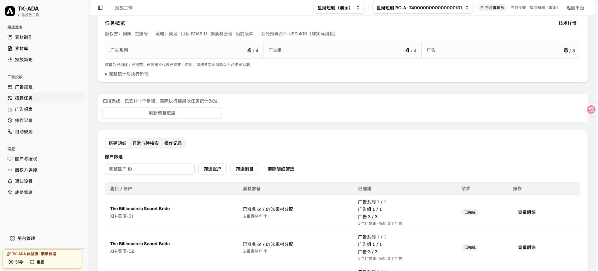
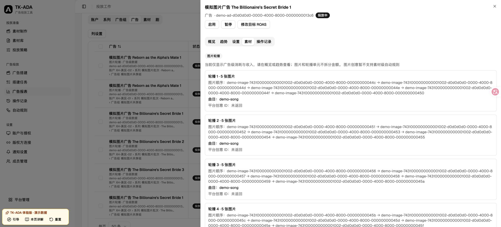
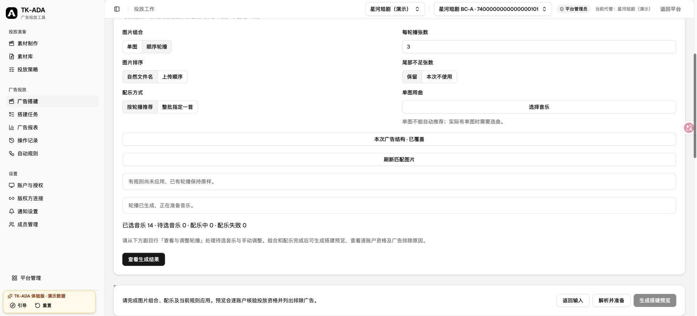

# 图片批次本地验收与待发布清单

记录日期：2026-10-30。范围为本地集成与未来验收方案。未调用真实 TikTok/R2，未选择真实 BC、连接或账户，未部署、推送、备份或恢复线上数据。合成演示、传输替身和真实平台验收分开记录。

## 当前合同与本地证据

新预览使用 V2。0059 将可编辑视频草稿迁为有序单元；0060 附加明确 V1 合同和历史布局；当前 head 为0061。旧冻结正文、哈希和原请求身份不改写。旧预览可因草稿版本提升转 OBSOLETE，这不等于改写正文。

未提交 V1 仅历史查看，新提交返回 preview_contract_expired。已有 request_id 和同预览新别名均返回原提交，不增加执行任务。未变草稿复用锁内 revision 提升生成唯一 V2；丢失响应重放返回同一个新预览且不重复排队。

所有本地 PG 升级使用 historical_database 的随机 migration_*_test 库，仅清理该夹具；共享库不降级。Redis 显式使用本地 DB14，不 FLUSH。

| 检查 | 结果与边界 |
| --- | --- |
| test_creative_unit_upgrade.py + test_video_unit_migration.py | 6 passed；新提交阻断、已有提交重放、重生成唯一性、真实0059→0061旧/混合历史guard、未知head拒绝、0058→0059视频草稿可编辑 |
| python3 scripts/test-release-tools.py | 53 passed；显式迁移guard失败先于snapshot/迁移，复查可通过；普通发布/备份行为保留 |
| workspace image-delivery + build-preview | 49 passed；40图上传完成、规则/单图音乐、V2分页、UNKNOWN核查、广告级轮播报表；全程无真实API请求 |
| scripts/generate-client.sh 后 frontend build | 官方客户端串行生成，生产与demo构建通过；既有构建警告如实保留 |

后续定向回归、E2E及静态门禁输出见 T5 实施报告及根代理的全分支复核。合成通过不证明平台格式资格。旧库夹具保留 UNKNOWN 原正文/digest，升级后仍阻断；这是混合历史失败关闭验证，不是允许生产绕过排空。未执行 downgrade，不能在产生 V2 数据后承诺数据库回退。

## 操作路径与合成演示

素材库“批量上传”选择静态 JPG/JPEG、PNG。上传40张图片与单轮播最多35图是不同边界；20 MiB、1600万像素是本服务准入，不是平台硬限制结论。

图片批次“准备与调整”顶部“整批图片规则”设置单图/顺序轮播、N张、排序、余数及配乐。先“查看生成结果”核对新增、保留、替换和保护损失，再“应用并生成”；默认保留手工保护，不自动清空排除项。组合或音乐未就绪不能预览。

剧目行“查看与调整轮播”打开侧栏，图片修改点“保存图片调整”；“换音乐”后搜索、选曲、“使用这首音乐”。完成后核对待选归零。图片和音乐分别保护；所选剧批量操作确认范围。“本次广告结构”只影响当前草稿，“投放策略”保存可复用结构。N图片/单元、M单元/基础广告、K文案版本不可混淆。

本地入口 /demo/#/login → “自由体验”。固定草稿为 /tenants/d0d0d0d0-0000-4000-8000-000000000065/build-drafts/d0d0d0d0-0000-4000-8000-0000000002d3?bc_id=7400000000000000101。全部租户、BC、账户、图片、曲目均虚构。

合成场景限定1共享组、M6、K1，不另复制后端策略引擎；其他结构明确显示演示范围错误。首剧61图13单元（末单图待选音乐），次剧5图1单元，两账户合计8广告。规则采用后，首剧第13单元选“晨光序曲”，完成→生成搭建预览。预览“账户组合”→“查看冻结详情”→展开第1组→按广告分页核对完整图片顺序和音乐。

新图片预览保持 PREPARING + carousel_music_unverified，可提交但目标账户原曲目须在发送前核验；预览不声称已核验音乐。正式产品提交具体预览后直接三层 ENABLE，无第二次激活流程。演示第一组合模拟远端创建成功但响应丢失，仅提供“核查待核实项”；核查读回同一对象，不重复创建。报表仅显示广告级模拟金额及有序图片/音乐，不分摊图片或轮播单元金额，不支持图片素材级自动规则。刷新页面重置合成状态。

## 待审查的上线切换方案（未执行）

1. 明确目标环境、精确旧/新 SHA、migration heads、租户/BC、四个现有开关、额度与并发。按2026-10-29规则，默认合同变更在停服前停止，不自动全备；只有另行明确选择才用 --full-backup。本轮没有线上备份/恢复证据。
2. 停止新入口和生产者，让旧消费者正常完成；先用只读 creative-unit-drain 检查。积压仍在则保留队列，按旧部署恢复消费者继续排空；UNKNOWN 按原意图核查，不强行失败、不清队列。
3. 锁与冻结窗口内再次检查并留存结果，全部通过才迁移。release 显式完整迁移候选含0060时，guard位于 pause 之后、snapshot/迁移之前；普通代码发布、backup、backup-online不新增旧合同排空。无备份迁移方案需单独审查，复用同一guard，不偷换为自动全备。
4. 迁移前失败可依现有 recover 正常恢复旧部署并复查；迁移开始后禁止自动启动旧程序或盲目降级，保留现场选择前进修复。不得用清卷/清队列替代恢复。
5. 核对 API、各 Worker、Beat 实际开关/额度与原选择一致。图片准入、轮播规则、预算和并发都是参数，不新增部署开关。
6. T4 历史数据审计：按目标租户/账户只读列出 material_post_link.main_material_type 的 distinct值/行数并核对广告金额。历史可含 VIDEO_NON_SPARK_ADS / VIDEO_SPARK_ADS 等原始类型；未知类型保留关系与广告金额，不能猜成VID或自动规则输入。本轮未线上查询，不声称历史均为规范VIDEO。

### 只读排空探测

旧应用辅助容器可通过stdin接收候选 deploy/release/probe.py 并运行 python - creative-unit-drain，复用现有release helper配置；不导入新ORM。人工执行同脚本必须检查输出 drained=true，不能只看退出码。

已知0060前head显式归V1，0060/0061按descriptor分类；未知/多head、缺表/查询错误不放行，0060之后缺descriptor单独阻断。每类最多返回一个ID样本，不输出正文或凭据：

- V1 BUILDING预览，包括尚无Submission的生成/续步任务；终态预览迟到消息由状态/代数守卫no-op。
- V1 Submission未expanded，或不在COMPLETED/PARTIAL/FAILED（含QUEUED/RUNNING/NEEDS_REVIEW）。
- V1 ExecutionStep为QUEUED/PENDING/RUNNING/RETRYABLE/UNKNOWN，即使父提交被标终态仍阻断。
- V2工作不计入V1阻断，进程退出与既有锁/队列保护仍独立保留。

## 真实平台验收待授权清单

状态：BLOCKED / UNVERIFIED。真实BC、官方SDK连接、身份、Minis、源/目标账户、图片摘要、音乐、币种和日预算均未选择，不沿用历史默认。当前功能只用官方SDK，不扩展退役MCP。

先形成具体ID、文件摘要、金额和对象名称清单，再取得仅限本次远端创建的明确授权：

| 用例 | 输入 | 必需回读 |
| --- | --- | --- |
| 单图单元 | 1张静态图片、明确曲目、1目标账户 | 源MID、目标image_id、音乐/顺序一致 |
| 三图轮播 | 3张有序图片、明确曲目 | 完整三图顺序，不缺图缩减 |
| 同一Ad两个单元 | 两个各3图单元，可同图不同曲 | 两单元及各自音乐可区分，不去重/拆分；不支持就记录不支持 |
| 第二目标账户共享 | 明确源和第二目标账户 | 各账户独立image_id映射与原始归属证据，不假设源目标ID相同 |

独立外部验收的Campaign、AdGroup、Ad均DISABLE，逐层回读所有父子对象为DISABLE，保存请求摘要/远端ID/响应证据；精确预算未填不得执行。此为另行授权的停用验收结构，不改变产品提交ENABLE，也不新增激活流程。

35图当前仅有本地合同/传输测试；上传40图只证明入口边界分离，不能宣称平台接受35图。真实35图、SDK接受、平台校验、回读完整各自记录。审核、音乐播放、滑动展示、价值优化与投入效果需另行具体启用/花费授权，明确对象、预算、时间窗和停用条件。停用创建成功不足以完成这些验收；未核实场景格式资格时生产继续阻断，不能用合成数据绕过。

## Computer Use 最终本地核验（2026-10-30）

使用最终静态演示构建（localhost:5186），整批规则应用后生成14个单元，为第一部剧尾部第13个单图选择“晨光序曲”；预览得到4个系列、4个广告组、8条广告，目标音乐显示提交后核验。冻结详情按2条广告分页，第二页保留单图及原选音乐。模拟提交的同一任务B830392从7/8广告待核实，经“核查待核实项”变为8/8；广告报表展示有序图片、原选音乐、广告级金额边界和素材自动规则限制，冻结链接回到原任务。

这是合成数据和模拟执行，未连接真实BC或平台写入。开发热更新/跨构建旧页面引起的会话重置不计入最终验收；最终稳定构建完整链路通过。

最终全局 `ruff check app tests`、`ty check app` 通过。全局格式检查仍有58个既有文件待格式化，同工具主分支基线为70个；本功能新增格式问题已处理，不声称全局格式全绿。此前聚合运行出现一次失败的场景恢复用例，本次定向1项通过，原聚合记录保持原结果。

## 总审查修复定向验收（2026-10-30）

总审查发现的原件清理后缩略图不可见、未应用本地规则仍可预览及演示夹具循环初始化，统一完成一轮修复。缩略图在原件不可读或 URL 失效时，仅回退到当前草稿 BC 的已授权平台图片；平台失败显示不可用，不触发上传。

最后一轮图片编排与交付浏览器回归24项通过（含8项新增回归），图片预览 PG/SDK 9项及既有视频/跨BC预览5项通过。生产与演示构建、官方客户端生成、聚焦 Ruff/ty、Bun独立导入通过；沿用前述既有格式/测试类型检查警告，不声明全套检查全绿。

Computer Use 单独验证：音乐全部就绪时可预览；整批 N 从5改3后按钮禁用；只查看差异再返回仍禁用；应用并等待读回完成后恢复；逐剧 N 改4并关闭侧栏后再次禁用。截图为最后一步。原件清理、URL失效及授权撤销由浏览器请求替身和真实PG授权测试覆盖，未以CUA伪造清理，也未访问真实平台。

修复提交07ca7837的定向复审结论：全部3项ADDRESSED，未发现新增问题，可合并本地main。随后整合main 1f4a01fb（查询预算嵌套恢复）至4470a787；`TEST_REDIS_URL=redis://localhost:6379/14 uv run pytest tests/modules/reporting/test_nested_query_budget.py tests/modules/reporting/test_carousel_ad_links.py tests/modules/reporting/test_planning_commits.py tests/modules/reporting/test_material_links.py -q` 结果 **73 passed / 33.42s**。该整合没有改变已验收的界面和缩略图代码。
