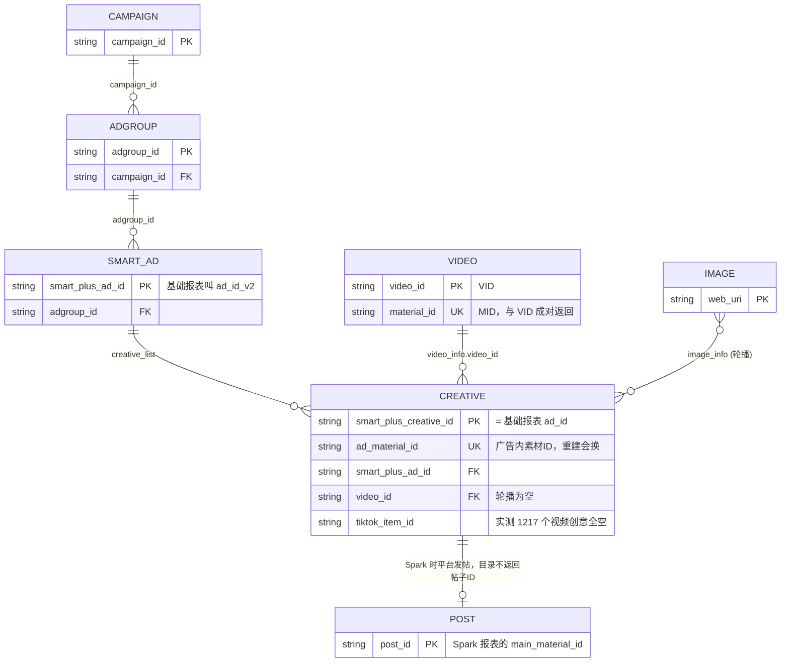
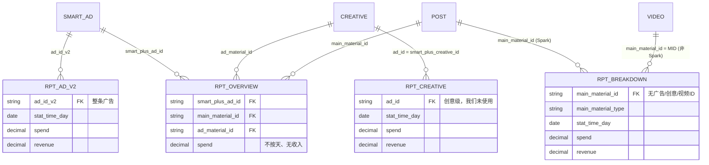
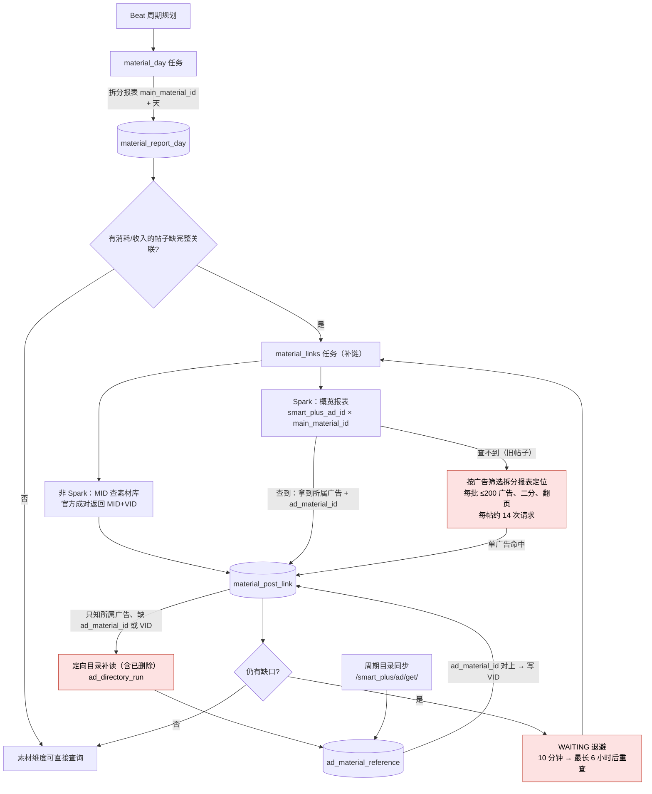

# 素材报表 ID 关联 ER 图与同步流程

依据：官方文档（Get Upgraded Smart+ Ads、Creative Overview/Breakdown、Basic Reports 维度）与 2026-11-10 生产只读核验。实线 = 官方接口直接返回的字段关联；标”定位”的是我们靠筛选推断出来的归属，不是平台返回的字段。

## 报表类型说明

| 缩写 | 全称 | 中文说明 | 数据粒度 |
| --- | --- | --- | --- |
| RPT_AD_V2 | Basic Report (ad_id_v2) | 基础报表广告维度 | 整条广告汇总，按天 |
| RPT_CREATIVE | Basic Report (ad_id) | 基础报表创意维度 | 创意级明细，按天 |
| RPT_OVERVIEW | Material Overview | 素材概览报表 | 广告×素材分组，不按天，无收入 |
| RPT_BREAKDOWN | Material Breakdown | 素材拆分报表 | 素材级明细，按天，带收入，只有帖子ID |

## 1. 平台对象与报表行 ER 图

## 2. 本地表 ER 图

## 3. 素材报表同步流程

红色节点是积压来源：旧帖子定位（请求最多）、定向目录补读（占目录队列约 55%）、等待退避重查（与目录队列互相等待）。

## 4. 哪些关联是官方直接给的

| 关联 | 来源 | 官方直接返回 |
| --- | --- | --- |
| 创意 → 广告、视频、`ad_material_id` | `/smart_plus/ad/get/` 的 `creative_list` | 是 |
| 非 Spark 报表行 → 视频 | 报表 `main_material_id` 即 MID，素材库成对返回 VID | 是 |
| Spark 帖子 → 广告 + `ad_material_id`（当前素材） | 概览报表 `smart_plus_ad_id × main_material_id` | 是 |
| Spark 旧帖子 → 广告 | 按 `smart_plus_ad_ids` 筛选拆分报表，看帖子是否出现 | 否，靠筛选推断 |
| 创意报表行 → 创意 | 基础报表 `ad_id` = `smart_plus_creative_id`（官方文档原文） | 是 |

## 5. 实测结论（2026-11-10，新骏伯 BC，`tiktok-ads-new-junbo`，只读）

账户 `7696728186688061460`，2026-11-02 至 11-08，全部分页取回。原始回执：`.runtime/report-dimension-audit-20261110/evidence.json`。

| 查询 | 行数 | 消耗 | Native Growth 总收入 |
| --- | ---: | ---: | ---: |
| 基础报表 `ad_id_v2` × 天（整条广告） | 66 | 253.18 | 167.90 |
| 基础报表 `ad_id_v2` + `video_material_id` × 天 | 117 | 253.18 | 平台拒绝（40002，维度与指标无关联） |
| 基础报表 `ad_id` × 天（创意） | 117 | 253.18 | 167.91 |
| Smart+ 素材拆分报表 | — | 0.35 | — |

- `video_material_id` 能拿消耗，但拿不到 `native_growth_*`，`onsite_*` 收入也被拒绝。商务中心能按视频看消耗，不代表 API 能按视频拿收入。
- `video_material_id` 是素材库 MID，不是上传返回的 VID，仍要经素材库映射。
- 创意级 `ad_id` 同时有消耗和收入，61 个创意全部能经目录 `creative_ids` 接到视频。
- 本地 `material_post_link` 允许一帖对应多条广告，此前“主键导致丢关联”的判断是错的，已撤回。
- “每帖 14 次请求”是历史任务累计请求数 ÷ 已检查帖子数，不是每帖固定开销。

结论：素材经营数据的主链路应改为“基础报表创意日报（`ad_id`） → 目录创意 → 视频/轮播”。素材拆分报表和帖子补链只保留给创意级报表里已经消失的重建旧创意（xuyin 样本约 3.8% 消耗）。改造前仍需在更多账户上核验历史覆盖、轮播和删除创意。
