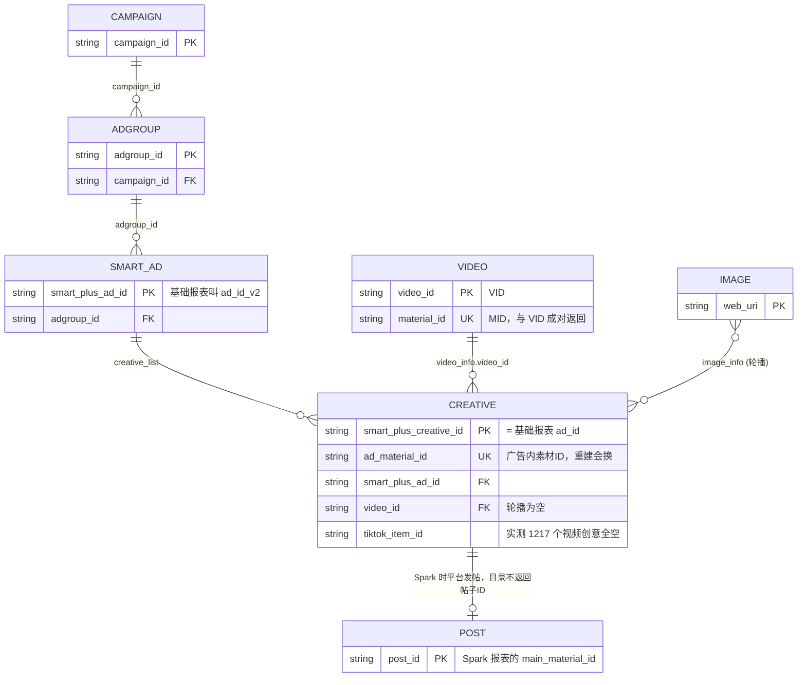
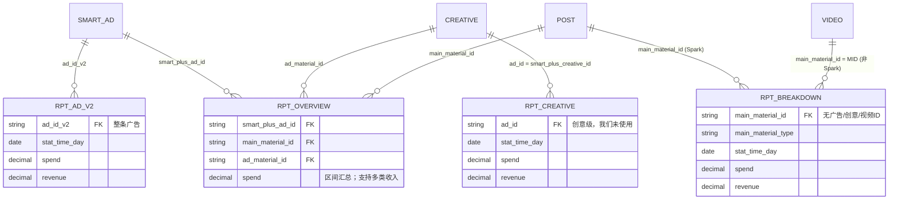
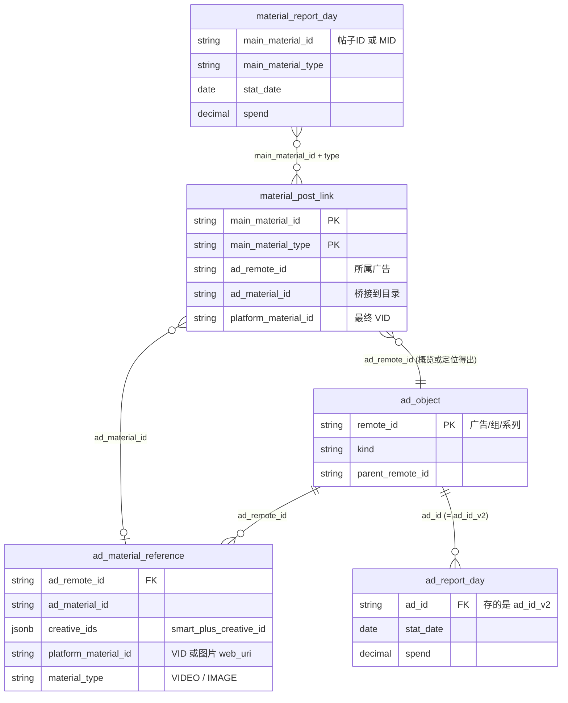
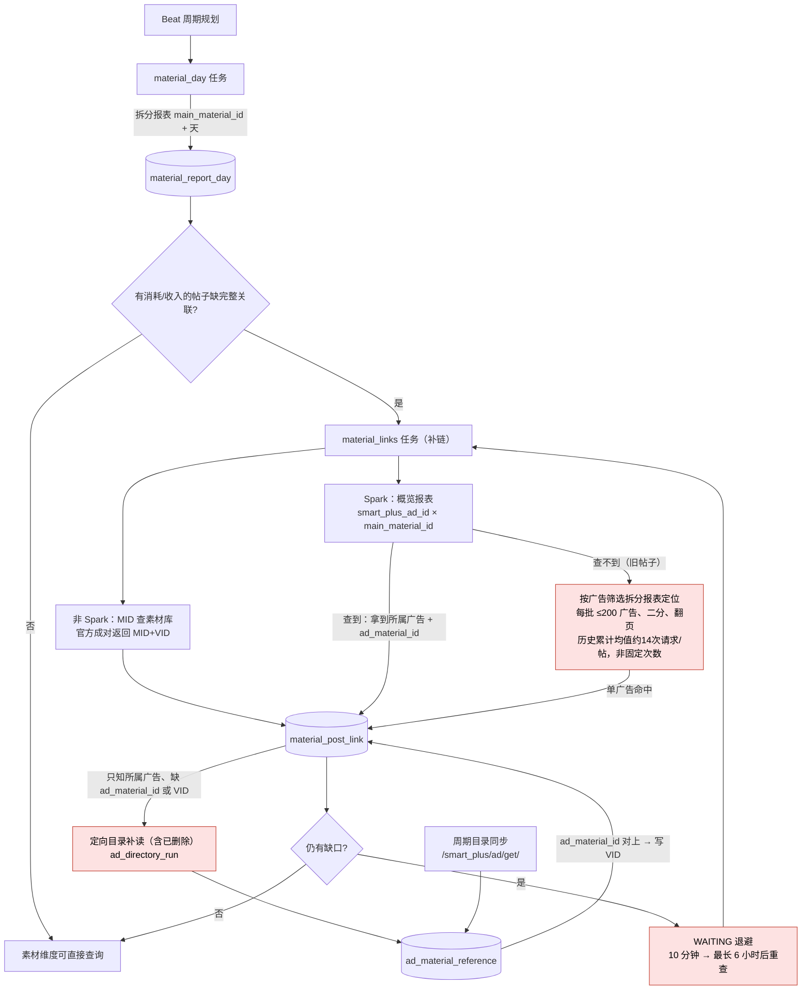
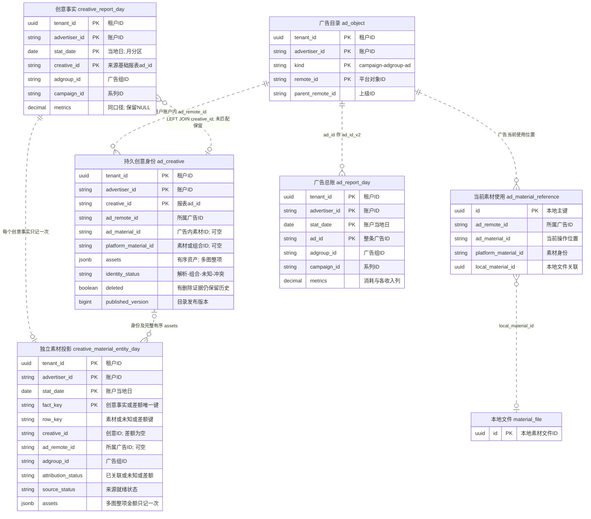
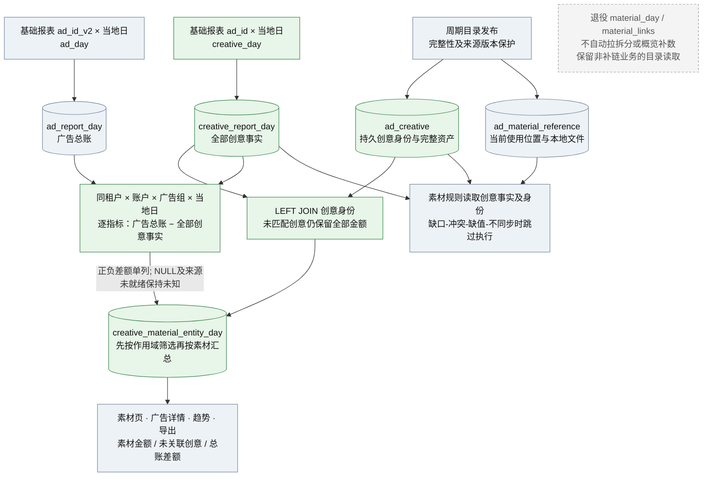
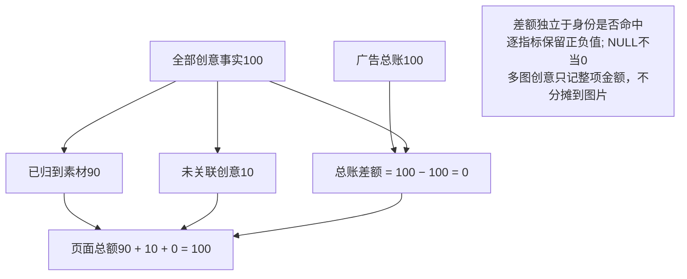
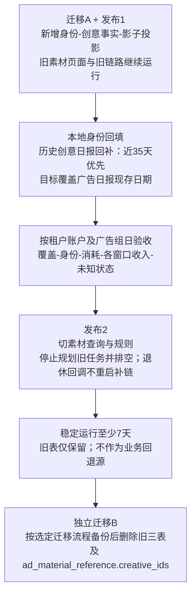

# 素材报表 ID 关联 ER 图与同步流程

依据：官方文档（Get Upgraded Smart+ Ads、Creative Overview/Breakdown、Basic Reports 维度）与 2026-11-10 生产只读核验。2026-11-11 已补入最新批准目标（§7）及完整官方文档调查的口径修正（§8）。实线 = 官方接口直接返回的字段关联；标”定位”的是我们靠筛选推断出来的归属，不是平台返回的字段。

## 报表类型说明

| 缩写 | 全称 | 中文说明 | 数据粒度 |
| --- | --- | --- | --- |
| RPT_AD_V2 | Basic Report (ad_id_v2) | 基础报表广告维度 | 整条广告汇总，按天 |
| RPT_CREATIVE | Basic Report (ad_id) | 基础报表创意维度 | 创意级明细，按天 |
| RPT_OVERVIEW | Material Overview | 素材概览报表 | 广告层级×组件分组，不按天；支持收入，具体指标有限制 |
| RPT_BREAKDOWN | Material Breakdown | 素材拆分报表 | 主素材或设置组件组合；支持小时/天/周/月，带 onsite 等收入 |
| RPT_VIDEO | Basic Report (video_material_id) | 基础报表视频素材维度 | 按MID汇总，受专门的指标与组合限制 |
| RPT_CREATIVE_API | Video Insights (/creative/report/get/) | 视频洞察报表 | 以视频为行，跨账户/区间汇总，含付费、自然及获得的页面互动 |

## 1. 平台对象与报表行 ER 图

## 2. 本地表 ER 图

## 3. 素材报表同步流程

红色节点是积压来源：旧帖子定位（请求最多）、定向目录补读（占目录队列约 55%）、等待退避重查（与目录队列互相等待）。

## 4. 哪些关联是官方直接给的

| 关联 | 来源 | 官方直接返回 |
| --- | --- | --- |
| 创意 → 广告、视频、`ad_material_id` | `/smart_plus/ad/get/` 的 `creative_list` | 是 |
| 非 Spark 报表行 → 视频 | 报表 `main_material_id` 即 MID，素材库成对返回 VID | 是 |
| Spark 帖子 → 广告 + `ad_material_id`（当前素材） | 概览报表 `smart_plus_ad_id × main_material_id` | 是 |
| Spark 旧帖子 → 广告 | 按 `smart_plus_ad_ids` 筛选拆分报表，看帖子是否出现 | 否，靠筛选推断 |
| 创意报表行 → 创意 | 基础报表 `ad_id` = `smart_plus_creative_id`（官方文档原文） | 是 |

## 5. 实测结论（2026-11-10，新骏伯 BC，`tiktok-ads-new-junbo`，只读）

账户 `7696728186688061460`，2026-11-02 至 11-08，全部分页取回。原始回执：`.runtime/report-dimension-audit-20261110/evidence.json`。

| 查询 | 行数 | 消耗 | Native Growth 总收入 |
| --- | ---: | ---: | ---: |
| 基础报表 `ad_id_v2` × 天（整条广告） | 66 | 253.18 | 167.90 |
| 基础报表 `ad_id_v2` + `video_material_id` × 天 | 117 | 253.18 | 平台拒绝（40002，维度与指标无关联） |
| 基础报表 `ad_id` × 天（创意） | 117 | 253.18 | 167.91 |
| Smart+ 素材拆分报表 | — | 0.35 | — |

- `video_material_id` 能拿消耗，但拿不到 `native_growth_*`，`onsite_*` 收入也被拒绝。商务中心能按视频看消耗，不代表 API 能按视频拿收入。
- `video_material_id` 是素材库 MID，不是上传返回的 VID，仍要经素材库映射。
- 创意级 `ad_id` 同时有消耗和收入，61 个创意全部能经目录 `creative_ids` 接到视频。
- 本地 `material_post_link` 允许一帖对应多条广告，此前“主键导致丢关联”的判断是错的，已撤回。
- “每帖 14 次请求”是历史任务累计请求数 ÷ 已检查帖子数，不是每帖固定开销。

结论：素材经营数据的主链路应改为“基础报表创意日报（`ad_id`） → 目录创意 → 视频/轮播”。素材拆分报表和帖子补链只保留给创意级报表里已经消失的重建旧创意（xuyin 样本约 3.8% 消耗）。改造前仍需在更多账户上核验历史覆盖、轮播和删除创意。

## 6. 扩大样本核验（2026-11-10，新骏伯 BC，Codex 只读）

范围：2026-10-26 至 11-08，Smart+ 消耗前 10 账户，392 个广告组日。证据：`.runtime/creative-coverage-audit-20261110/summary.md`。

- 创意级（`ad_id`）与整条广告（`ad_id_v2`）：消耗 6,130.14 = 6,130.14，每个广告组日差额都是 0；总收入差 $0.01，单个广告组日最大差 $0.04。较早日期和近期没有区别。
- 创意 → 目录：VIDEO 占 96.46%（407 个创意）；MCP 目录查不到的 3.54%（25 个创意，$216.79）在 4 个 daihua 账户的 4 个广告组。
- 这 25 个创意已核实（2026-11-11，生产 Pod 只读，`probe_notfound.txt`）：都是已删除的创意（`/ad/get/` 返回 `secondary_status=AD_STATUS_DELETE`，仍带 `video_id`），当前 `smart_plus_ad_get` 的 creative_list 里已没有。本地 `ad_material_reference` 25 个全部有记录并带 VID。所以按本地目录映射，覆盖率 100%。
- 轮播（2026-11-11，xuyin BC 7673415075352576016 两个账户，11-03 至 11-09，`probe_carousel.txt`）：223 个有消耗的轮播创意全部是 `ad_format=CAROUSEL_ADS`、**每个创意只有 1 张图**，本地目录 1 行、1 个 `ad_material_id`；平台没有“轮播组”ID，曲目都是同一首。同一张图被 2 个创意（分属不同广告）复用的有 28 张。结论：轮播按 `web_uri`（图片）汇总即可，与视频按 VID 汇总同一个做法。样本当周消耗只有 $33.81，结构结论可信，金额占比不代表常态。

## 7. 最新批准方案（2026-11-11）

依据 [改造计划](../superpowers/plans/2026-11-11-creative-report-material-rebuild.md) §3–§13。以上 §1–§4 保留历史结构；以下是批准目标，不表示生产已经切换。

- 广告总账保留 `ad_id_v2`；素材来自 `ad_id` 创意日报，通过 `ad_creative` 做 LEFT JOIN。连接始终限定租户、账户，日期按账户当地日。
- `ad_material_reference` 保留当前位置及文件关联，`creative_ids` 由独立后续迁移删除。目录部分缺失不能判删除，历史身份和冲突证据保留。
- 新增独立 `creative_material_entity_day`，发布1影子运行，发布2切换。多图保存完整有序资产，整项金额只记一次。
- 未关联创意和总账差额分开：广告100、全部创意100、映射90时，素材90 + 未关联10 + 差额0。逐指标保留正负值、NULL和来源未就绪状态。
- 回补覆盖广告日报现存日期，近35天优先；本期仅展示差额，不自动补数。发布2稳定至少7天后，独立迁移B删除旧三表及 `creative_ids`。

### 目标表关系

### 目标同步与查询

### 金额对账

### 分阶段迁移

图源及渲染配置保存在 [diagrams/2026-11-11-creative-material](diagrams/2026-11-11-creative-material/)。本地HTML沿用 `.runtime/backlog-rootcause-20261110/material-id-er.html`，已移除旧的按金额门槛自动补数说明。

## 8. 官方完整文档口径修正（2026-11-11）

- Smart+ 素材概览和细分都引用[同一广告层级指标总表](https://business-api.tiktok.com/portal/docs/supported-ad-level-metrics-for-upgraded-smart-creative-reports/v1.3)，包括收入和ROAS。此前将概览概括成“无收入”不准确；应区分具体指标族及合法维度。
- [概览](https://business-api.tiktok.com/portal/docs/run-an-upgraded-smart-creative-overview-report/v1.3)在 `smart_plus_ad_id × main_material_id` 分组时可取 `smart_plus_creative_id`/`smart_plus_creative_name` 列表；这也是官方提供的关系，不能仅记录 `ad_material_id`。
- [VIDEO_INSIGHT指标表](https://business-api.tiktok.com/portal/docs/supported-metrics-in-video-insights-reports/v1.3)列出45个字段，除了消耗、展示、点击，还有转化/结果、播放、社交及自然/获得的页面互动；未列出 Native Growth 或 onsite 收入字段。不能再称其“只返回消耗、曝光、点击”。
- 当前[VIDEO_INSIGHT响应正文](https://business-api.tiktok.com/portal/docs/video-insights-reports-reference/v1.3)列出素材MID与 `tiktok_item_ids`，未列 `related_ad_ids` 或 `video_id`；平台图按当前已确认字段绘制，不再将旧说法画成已证实的直接广告关系。
- [基础报表视频维度](https://business-api.tiktok.com/portal/docs/basic-reports-supported-dimensions/v1.3)有独立指标限制，包括 `video_views_p100`。历史实测 Native Growth收入返回40002，只证明该请求组合，不能推广为所有收入类字段永远不可用。

完整独立调查及可搜索字段全集位于工作区 `docs/research/TikTok官方报表用途与维度指标对照-20261111.html`，不把本地工具的表结构当成官方接口设计原因。
